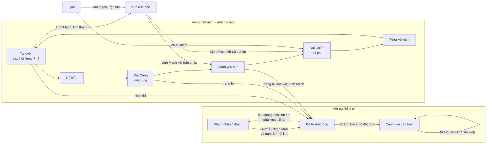

# Bản đồ Sơn Hà Tiên Lộ — tra cứu toàn game

Trang này là **bản đồ**: mọi hệ thống, tài nguyên, lệnh và chỗ nằm trong mã nguồn, mỗi thứ một dòng. Luật chi tiết
và lý do trong truyện nằm ở [kinh-thu.md](kinh-thu.md). Thêm hay đổi hệ thống nào thì **sửa trang này trong cùng
lần sửa**, theo bảng kiểm ở §9.

Trạng thái: ✅ đã chạy trong game · 🟡 đã có lõi, thiếu tranh hoặc thiếu hiển thị · ⬜ mới thiết kế.

## 1. Bức tranh tổng

Game chạy trên **một màn hình live**. Người xem chỉ có ba thứ: **bình luận, tim, quà**.

## 2. Các màn (pha) — mỗi màn một việc, một điểm nhấn

| Màn | Mã pha | Người chơi làm gì | Điểm nhấn trên màn | Sinh ra | Trạng thái |
|---|---|---|---|---|---|
| Tu luyện | `cho` `hoi` `dap` | gõ A / B / C (câu đố), **gõ số 1–7** (§3i) và **8 Lôi Đài** tỉ thí cùng tông (§3j) | kim tự tháp một phe, bảng "Chơi nhanh · gõ số", thẻ sự kiện có đếm ngược, chữ to giữa màn, mạch Tụ Linh Trận, màn Đột Phá (cả khung chỉ khi lên Hóa Thần trở lên và cách màn to trước ≥ 3 phút; còn lại — phần lớn — chỉ cột sáng + chữ "⚡ cảnh giới" nhỏ trên đầu — `DP_TO_*` trong `Stage.tsx`) | linh khí, Linh Mạch, linh thạch | ✅ |
| Độ kiếp | `kiep` `kiep-ket` | cả phòng gõ **1 / 2 / 3** (hay A / B / C, `độ`) để hộ pháp; người độ kiếp chỉ ngồi chịu sét — **không còn câu hỏi** | tiêu đề "Độ Kiếp" + dòng răn "Thất bại thì thân tử đạo tiêu"; người độ kiếp to giữa màn, sét; không thẻ nào che cảnh, số hộ pháp ở thẻ Lệnh bên trái | đủ hộ pháp: chắc qua + Phúc Lộc ×2 cả phòng; thiếu: tự vượt 30% + 60% × (hộ pháp / cần) (`KIEP_TU`, `KIEP_TU_HO`); ngã thì chờ 3 phút, chỉ **5%** rớt một cảnh giới (`KIEP_ROT`); **mỗi người hộ pháp** được +4 linh khí hoặc 20% trúng cơ duyên +3 linh thạch, kiếp qua thì ×2 (`thuongHoPhap`); hai lượt độ kiếp cách nhau ≥ 3 phút (`KIEP_CACH`, `Nhip.kiepCach`; bản thử 90 giây) — ai tới lượt thì chờ | ✅ |
| Thử Thách Nhập Môn (Ải, mê cung cấp 1; tiêu đề màn đổi theo) | `nm` `nm-ket` | khách gõ **1** Nam Sơn · **2** Nữ Sơn · **3** Nam Thủy · **4** Nữ Thủy trong 30 giây để bước vào (`Nam S`… vẫn được); 60 giây gõ **1** lên · **2** xuống · **3** trái · **4** phải (`1 1 1` hay `lên 3` đi ba bước) tới đúng cửa tông | bảng hướng dẫn + đồng hồ lớn, hàng người chờ trước lối vào, vật phẩm rơi trên đường, Vinh Danh người vượt ải kèm trang phục | đệ tử mới, trang phục, đồ, bí kíp võ công | ✅ |
| Tranh Đoạt Bảo Vật (Địa Cung, mê cung cấp 2; tiêu đề màn đổi theo) | `me` `me-ket` | chỉ đệ tử; gõ **1** lên · **2** xuống · **3** trái · **4** phải (hay chữ), mỗi lệnh một bước | bản đồ mê cung, Vinh Danh | trang bị, Linh Mạch | ✅ |
| Yêu tinh | `yeu` `yeu-ket` | gõ **5** đánh (`đánh` vẫn được); yêu tinh báo chiêu lớn thì gõ đúng số **1–4** đỡ; tim hồi máu; quà kết trận pháp | 7 boss bốc ngẫu nhiên, chữ to báo chiêu + đếm ngược, phản đòn, Vinh Danh | trang bị, linh vật, Linh Mạch | ✅ |
| Đại Chiến | `lu` `lu-ket` | tự đánh; bình luận tiếp sức; tim tăng bạo kích; quà ra chiêu | hai Chủ Tướng đối mặt, đội quân, Tuyệt Kỹ, đấu tướng | thế trận mùa, Linh Mạch | ✅ |
| Thành Trì Tự Do | `tt` | cả hai tông gõ `D1`–`D9` mua đan ở Đan Các, `C1`–`C9` học chiêu ở Tàng Kinh Các (mỗi tông một bộ tên chiêu) | nền chợ `nen/cho.webp`, khung hai quầy (Tàng Kinh Các đổi tông mỗi 7 giây), tên món bay trên đầu người mua | đan, công pháp | ✅ |
| Tổng kết | `mua-ket` | — | pháo hoa phe thắng | mùa thắng | ✅ |
| Sự kiện giờ | (dùng lại các màn) | theo lịch người vận hành | bản "đại" | như màn gốc | ✅ |

Thứ tự ưu tiên khi chọn màn kế: hàng độ kiếp → việc tới giờ trong **lịch trình** (§11) → Ải Nhập Môn xen mỗi `nmCach` phút nếu có khách chờ (theo lịch mỗi giờ thì chỉ khi xong kịp trước mốc kế) → yêu tinh → Đại Chiến → Địa Cung → tổng kết →
câu hỏi. Mã: `batDauTiep()` trong `loi/core.ts`. Nhịp thời gian: `NHIP_LIVE`, `NHIP_THU`.

## 3. Tài nguyên — ai giữ, sinh ở đâu, tiêu ở đâu

| Tài nguyên | Của | Sinh ra | Tiêu vào | Lưu sổ | Trạng thái |
|---|---|---|---|---|---|
| **Linh khí** (`lk`) | người | đáp đúng, tim (tối đa 15 / 10 phút), tham gia trận, thoát Địa Cung, hộ pháp, cộng hưởng trận | dừng ở ngưỡng cảnh giới, gõ `đột phá` mới lên | `k` | ✅ |
| **Cảnh giới** (`canh`, 0–9) | người | gõ `đột phá` (dưới Nguyên Anh), độ kiếp (từ Nguyên Anh) | — | `c` | ✅ |
| **Công, thủ, lực chiến** | người | theo bảng §3c: cảnh giới + trang bị + công pháp | sát thương yêu tinh, đỡ phản đòn, hệ số trong PK | tính ra | ✅ |
| **Trang bị** (`tb`: binh khí, giáp y, bảo vật × 5 phẩm × biến thể a/b/c) | người | ban 3 món Phàm khi nhập môn; Địa Cung, yêu tinh, Đại Chiến, Rương Đồng rơi | mặc nếu tốt hơn và đủ cảnh giới, không thì luyện hoá thành linh khí | `g` | ✅ |
| **Linh vật** (`linhVat`) | người | hạ yêu tinh (kết liễu, top sát thương) | +5% linh khí mỗi con (tối đa 4) | `v` | ✅ |
| **Linh thạch** (`tinChi`, tên cũ tín chỉ) | người | quà, đột phá (mình và cả phòng), mốc tim, trận phe — xem §3b | đan dược, võ công (đã có); trang phục, pet, linh thú (chưa) | `tc` | ✅ |
| **Võ công** (`vo`, 0–5) | người | gõ `học võ`, tốn linh thạch; bí kíp nhặt ở Ải Nhập Môn (+1 tầng) | — | `w` | ✅ |
| **Trang phục** (`ao`, T1–T9) | người | nhập môn được một bộ T1–T5; mua thêm ở Tàng Bảo Các (§3d) | chỉ đổi hình | `a`, `ac` | ✅ (đủ tranh 4 nhân vật) |
| **Trận lực nhánh** (`nhanh`) | người | quà của chính mình | cấp nhánh 0–4 (mốc 10 / 50 / 200 / 500 xu) | `nh` | ✅ |
| **Trận lực phe** (`tranLuc`) | phe | quà của môn đồ + 20 mỗi lần một nhánh lên cấp | cấp trận tu luyện 1–5 | `tr` | ✅ |
| **Linh Mạch** (`linhMach`) | phe | đáp đúng +1, thắng PK +15 (thua +5), hạ yêu tinh, thoát Địa Cung +2 | kết trận pháp (10 mỗi lần) | `lm` | ✅ |
| **Trận khí** (`H`) | phe, trong một trận PK | 25 × số người đang chơi (ít nhất 200) | cạn thì bị phá trận | không | ✅ |
| **Thế trận mùa** (`muc`, −5..5) | cả phòng | thắng PK, hạ yêu tinh | quyết định phe thắng năm | không | ✅ |
| **Mùa thắng** (`muaThang`) | phe | tổng kết năm | — | `mua` | ✅ |

### 3b. Bảng hệ số linh thạch (`THACH` trong `loi/the-gioi.ts`)

Mốc neo: **1 xu quà = 1 linh thạch**. Thêm nguồn hay món mới thì quy về bảng này để kinh tế không vỡ.

| Nguồn | Linh thạch | Ghi chú |
|---|---|---|
| Quà | 1 mỗi xu | quà lớn thì nhiều, theo đúng giá quà |
| Đột phá (người đột phá) | 5 × cảnh giới mới | Luyện Khí 5 … Bất Tử 45 |
| Đột phá (mỗi người đang online) | 1 × cảnh giới mới | online = có hành động trong 5 phút qua |
| Tim trong một buổi | mốc 50 / 200 / 500 / 1000 tim → 2 / 5 / 10 / 20 | mỗi mốc một lần mỗi buổi |
| Trận tu luyện của phe | cấp trận − 1 mỗi câu đúng | 0 … 4 |

| Tiêu vào | Giá | Trạng thái |
|---|---|---|
| Trang phục T1–T9 | 50 – 1000 (§3d) | ✅ |
| Đan dược D1–D9 | 20 – 560 (§3d) | ✅ |
| Công pháp C1–C9 | 30 – 480 (§3d) | ✅ |
| Pet P1–P9 | 100 – 1000 (§3d) | ✅ |
| Nuôi pet | dự kiến 10 mỗi lần cho ăn | ⬜ |

Ước lượng người chơi không tặng quà, chơi đều một giờ: khoảng 35 từ trận phe (cấp 2), khoảng 60 từ các lượt đột phá
trong phòng, khoảng 50 từ đột phá của chính mình, khoảng 7 từ tim — chừng **150 linh thạch một giờ**. Tức một giờ đủ
học võ tới tầng 2 hoặc luyện vài viên đan; món 500 cần hơn ba giờ hoặc 500 xu quà.

**Online và tổng lực chiến phe:** người quá 5 phút không có hành động mới (`DANG_CHOI`) không còn là online — không
nhận linh thạch của phòng, không ngồi trên màn, và lực chiến của họ **không cộng** vào tổng lực chiến phe
(`tongLuc()`, `dangChoi()`).

### 3c. Bảng hệ số lực chiến (mọi nguồn tăng sức mạnh)

**Lực chiến = công + thủ + công pháp.** Mọi nguồn tăng sức mạnh phải nằm trong bảng này, không tăng bừa. Nguyên tắc:
dưới Nguyên Anh mỗi bậc chỉ thêm **hàng chục**, từ Nguyên Anh thêm **hàng trăm**; đồ và công pháp không bao giờ
vượt cảnh giới (cả bộ Thiên phẩm ≈ 60% lực chiến gốc Đại Thừa). Mã: `CONG_CANH`, `THU_CANH`, `GOC_PHAM`, `VO_LUC`
trong `loi/trang-bi.ts`; `lucChienCua()` trong `loi/core.ts`.

**1. Nhân vật — cảnh giới** (lực chiến gốc, chưa đồ; công : thủ ≈ 55 : 45)

| Cảnh giới | 0 Phàm Nhân | 1 Luyện Khí | 2 Trúc Cơ | 3 Kết Đan | 4 Nguyên Anh | 5 Hóa Thần | 6 Luyện Hư | 7 Đại Thừa | 8 Chân Tiên | 9 Bất Tử |
|---|---|---|---|---|---|---|---|---|---|---|
| Công | 12 | 28 | 50 | 77 | 165 | 275 | 413 | 578 | 770 | 990 |
| Thủ | 8 | 22 | 40 | 63 | 135 | 225 | 337 | 472 | 630 | 810 |
| **Lực chiến gốc** | **20** | **50** (+30) | **90** (+40) | **140** (+50) | **300** (+160) | **500** (+200) | **750** (+250) | **1050** (+300) | **1400** (+350) | **1800** (+400) |

**2. Trang bị và vũ khí** — 3 ô: binh khí (công), giáp y (thủ), bảo vật (nửa công nửa thủ). Mỗi món lệch ±15%.

**Kho biến thể** (khớp Tàng Bảo Các `web/son-ha-tien-lo/js/tang-bao.js` → `BIEN_THE`): mỗi tông × phẩm × ô có 3 biến thể
a / b / c — cùng chỉ số, khác tên và hình. Mã `TEN_BIEN_THE`, `maDo`, `hinhDo`, `hopNguoi` trong `loi/trang-bi.ts`.
- `TrangBi.bt` = biến thể; `tg` / `gi` = tông, giới **người cầm** (đóng lên món khi nhận: `nhanDo`, nhặt trong mê
  cung, `dongTui` khi đổi tông / giới / nạp sổ). Tên: `tenDo` = tên riêng kho người vận hành → `TEN_BIEN_THE` → tên
  gốc `TEN_DO` (món cũ không có `bt`). Hình: ảnh riêng → `assets/do/kho/<B|G|V><phẩm><''|b|c>-<son|thuy>[-<nam|nu>].webp`
  (giáp y theo giới; 120 ảnh, chuyển từ `web/son-ha-tien-lo/tranh-goc/`) → `do/<ô>.webp` → biểu tượng (`HinhDo`).
- **Nhập môn được ban đồ** (`banDoNhapMon` trong `nhapPhe`): ô nào còn trống nhận 1 món Phàm phẩm của tông, biến thể
  bốc ngẫu nhiên, chỉ số `GOC_PHAM[0]` ±15% (bảng gốc, không theo kho người vận hành). Ô đã có đồ không ban lại.
- `taoDo` luôn bốc biến thể (rand cuối cùng); món rơi trên sân mê cung chưa có chủ thì chưa có tông (tên gốc), về tay ai
  thì mang tông + giới người đó.
- Sổ: `g[o] = [phẩm, công, thủ, biến thể?, tên riêng?, ảnh riêng?]`; sổ cũ 3 số vẫn đọc được (món không biến thể).
- Chưa có: mua trang bị bằng linh thạch, đổi kiểu trong cùng phẩm (chờ giá).

| Phẩm | Mặc từ | Binh khí: công | Giáp y: thủ | Bảo vật: công + thủ | Cả bộ ≈ | Rơi ở |
|---|---|---|---|---|---|---|
| Phàm | Phàm Nhân | 8 | 8 | 4 + 4 | 24 | Ải, Địa Cung, yêu tinh |
| Linh | Luyện Khí | 20 | 20 | 10 + 10 | 60 | như trên |
| Huyền | Kết Đan | 45 | 45 | 22 + 22 | 135 | như trên (hiếm hơn) |
| Địa | Hóa Thần | 120 | 120 | 60 + 60 | 360 | gần lõi Địa Cung, Rương Đồng, yêu tinh |
| Thiên | Đại Thừa | 250 | 250 | 125 + 125 | 750 | Rương Đồng, yêu tinh (rất hiếm) |

Chưa đủ cảnh giới để mặc thì món đồ được **luyện hoá** thành linh khí (`lkLuyenHoa`), không vào lực chiến.

**3. Công pháp (võ công)** — mỗi tầng +6% lực chiến gốc của cảnh giới hiện tại (tầng 5: +30%). Ngoài ra mỗi căn cơ
có hiệu ứng riêng trong trận (Kinh Thư §15). Lên tầng bằng linh thạch (`học võ`) hoặc bí kíp ở Ải Nhập Môn.

**4. Không cộng thẳng vào lực chiến** (tác động gián tiếp, ghi rõ để khỏi lẫn):

| Nguồn | Tác dụng | Lực chiến | Trạng thái |
|---|---|---|---|
| Đan dược — Tụ Khí Đan | +25 linh khí (đi nhanh tới đột phá) | 0 | ✅ |
| Linh vật (hạ yêu tinh) | +5% linh khí và sát thương yêu tinh mỗi con, tối đa 4 | 0 | ✅ |
| Trang phục cơ bản / đổi được | chỉ đổi hình | 0 | ✅ / ⬜ |
| Trận pháp, Linh Mạch | hiệu lực trong trận (công +30%, thủ, phá giáp, hồi) | 0 | ✅ |

**5. Dự kiến (giữ đúng thang này khi làm)**

| Nguồn | Hệ số dự kiến | Trạng thái |
|---|---|---|
| Pet P1–P9 | +5% → +18% công thủ gốc (§3d) | ✅ |
| Thú cưỡi | +5% lực chiến gốc, đi nhanh hơn trong mê cung | ⬜ |
| Pháp bảo của phe | không cộng cá nhân; mở trận pháp thứ năm | ⬜ |
| Đan dược trận (Bạo Khí Đan…) | +20% công trong một trận, không cộng lực chiến lâu dài | ⬜ |

**Lực chiến dùng ở đâu:** Đại Chiến so trong phe (`heSoNoiBo`, kẹp ×0,6–×1,8) và so hai phe (`heSoPheLuc`, kẹp
×0,8–×1,25) — tỉ lệ nên thang mới không làm lệch; đánh yêu tinh: sát thương = công, máu yêu tinh = tổng công đệ tử
đang chơi × số đòn tối đa trong trận × 0,2; đỡ phản đòn = thủ / (thủ + 600) cộng thưởng căn cơ.

Ví dụ: Kết Đan, cả bộ Linh phẩm, công pháp tầng 2 → 140 + 60 + 17 = **217**. Nguyên Anh, cả bộ Huyền phẩm, tầng 3 →
300 + 135 + 54 = **489**.

### 3d. Tàng Bảo Các — cửa hàng bằng mã (`loi/tang-bao.ts`)

Gõ **mã** trong bình luận: `T1`–`T9` trang phục, `D1`–`D9` đan dược, `C1`–`C9` công pháp, `P1`–`P9` pet (chữ hoa
thường, có cách hay không đều được). Món **chưa có** thì trừ linh thạch rồi dùng ngay; món **đã có** thì chỉ đổi sang
dùng, không mất gì. Không đủ linh thạch / chưa đủ cảnh giới / linh khí đã đầy (với đan linh khí) thì hiện thẻ tu vi để
người chơi tự xem. **Đang đánh (Đại Chiến, yêu tinh) thì không mua đổi được** — chọn trước, mang vào trận.

Trên màn: thẻ Lệnh ở màn tu luyện kèm một bảng Tàng Bảo Các, mỗi lần thẻ trượt ra là một loại (Trang phục → Đan dược
→ Công pháp → Pet). Thẻ tu vi (`tôi`) ghi món đang dùng và đan còn trong túi.

**Trang phục** — chỉ đổi hình, không cộng lực chiến. Nhập môn được tặng ngẫu nhiên một bộ T1–T5. Mặc gì thì ngồi
tu luyện, lên Vinh Danh đúng bộ đó (Đại Chiến và đánh yêu tinh dùng dáng chiến riêng).

| Mã | Sơn Tông | Thủy Tông | Giá | Cần | Tranh |
|---|---|---|---|---|---|
| T1 | Sơn Dã Y | Ngư Gia Y | 50 | — | `-tp1` |
| T2 | Hộ Sơn Giáp | Ngân Lân Giáp | 50 | — | `-tp2` |
| T3 | Bạch Vân Bào | Bạch Châu Bào | 50 | — | `-tp3` |
| T4 | Hồng Hội Bào | San Hô Bào | 50 | — | `-tp4` |
| T5 | Dạ Hành Y | Nguyệt Dạ Y | 50 | — | `-tp5` |
| T6 | Lạc Vũ Pháp Y | Lam Thủy Pháp Y | 100 | Luyện Khí | `-c1` |
| T7 | Nguyên Anh Sơn Bào | Nguyên Anh Long Bào | 300 | Nguyên Anh | `-c4` |
| T8 | Hư Không Sơn Giáp | Hư Không Hải Giáp | 600 | Luyện Hư | `-c6` |
| T9 | Bất Tử Thần Y | Bất Tử Long Y | 1000 | Chân Tiên | `-c9` |

**Đan dược** — D1–D5 là **điểm đột phá** (linh khí), uống ngay; D6–D9 là đan trận, cất trong túi, **tự dùng** khi vào
trận kế (lần ra tay đầu ở Đại Chiến / đánh yêu tinh) hoặc lần độ kiếp kế.

Đan linh khí mang **tên cảnh giới dùng nó** và chỉ bán từ cảnh giới đó (`can` trong `DAN`): linh khí mỗi viên không
vượt khoảng cách tới cảnh giới kế của cảnh giới ấy (mới vào cảnh giới mà uống là không phí giọt nào — `congLk` dừng ở
ngưỡng); đan bậc cao lời hơn (linh khí / linh thạch: 1,25 → 1,39 → 1,5 → 1,59); Phá Cảnh Đan lỗ ở Nguyên Anh, lời ở bậc
cao (trả cho sự tiện). Luật giữ bằng `tests/.../nhat-quan.test.ts`.

| Mã | Tên | Giá | Công dụng | Từ | Dùng ở |
|---|---|---|---|---|---|
| D1 | Tụ Khí Đan | 20 | +25 linh khí | mọi cảnh giới | ngay |
| D2 | Bồi Nguyên Đan | 36 | +50 linh khí | Luyện Khí | ngay |
| D3 | Trúc Cơ Đan | 60 | +90 linh khí | Trúc Cơ | ngay |
| D4 | Kết Kim Đan | 88 | +140 linh khí | Kết Đan | ngay |
| D5 | Phá Cảnh Đan | 560 | đầy linh khí tới ngưỡng đột phá (vẫn phải gõ `đột phá`) | Nguyên Anh | ngay |
| D6 | Bạo Khí Đan | 60 | công +20% hết trận (Đại Chiến: đòn ×1,2; yêu tinh: sát thương ×1,2) | mọi cảnh giới | trận kế |
| D7 | Kim Cương Đan | 60 | thủ +20% hết trận (yêu tinh: đỡ phản đòn +15%; Đại Chiến: đòn ×1,1) | mọi cảnh giới | trận kế |
| D8 | Hồi Hồn Đan | 40 | đỡ trọn một lần choáng do yêu tinh phản đòn | mọi cảnh giới | khi bị choáng |
| D9 | Hộ Kiếp Đan | 80 | +2 hộ pháp ngay đầu lần độ kiếp | Kết Đan | độ kiếp kế |

**Công pháp** — chọn **một** môn đang dùng; hệ và bậc của môn đó quyết định hiệu ứng trong trận, và **tên môn là tên
chiêu** hiện khi người đó ra đòn (Chủ Tướng Đại Chiến ra đòn bằng chiêu của mình). Lực chiến +6% lực chiến gốc mỗi
bậc (§3c). Bậc cao phải đủ cảnh giới mới học (`CANH_CP`: bậc 2 từ Luyện Khí, 3 Trúc Cơ, 4 Kết Đan, 5 Nguyên Anh), giá
gấp đôi mỗi bậc (`GIA_CP`). Tác dụng mỗi bậc theo hệ nằm một chỗ (`HE_CP` trong `tang-bao.ts`): lõi trận và dòng công dụng
trên quầy (`moCong`) cùng đọc, nên chữ không lệch số. Gõ `học võ` là mua môn rẻ nhất chưa có mà đủ cảnh giới. Bí kíp ở
Ải Nhập Môn tặng một môn chưa có, hợp cảnh giới.

| Mã | Sơn Tông (cung) | Thủy Tông (lao) | Hệ | Bậc (từ) | Giá | Trong trận |
|---|---|---|---|---|---|---|
| C1 | Sơn Ưng Tiễn | Thủy Xà Thương | đòn (Chiến Tướng) | 1 | 30 | đòn +8% |
| C2 | Thạch Bích Công | Thủy Mạc Công | đỡ (Hộ Vệ) | 1 | 30 | đỡ phản đòn +5%, đòn +3% |
| C3 | Linh Chi Quyết | Ngọc Châu Quyết | hồi (Y Sư) | 1 | 30 | mỗi đòn tiếp sức hồi trận khí 0,06, đòn +3% |
| C4 | Xuyên Vân Tiễn | Xuyên Lãng Thương | bạo (Phá Quân) | 2 (Luyện Khí) | 60 | bạo kích +6%, đòn +10% |
| C5 | Phá Sơn Liên Tiễn | Phá Lãng Thương Pháp | đòn | 2 (Luyện Khí) | 60 | đòn +16% |
| C6 | Tản Viên Hộ Thể | Long Lân Hộ Thể | đỡ | 3 (Trúc Cơ) | 120 | đỡ +15%, đòn +9% |
| C7 | Mộc Linh Hồi Xuân | Hồi Xuân Thủy Pháp | hồi | 3 (Trúc Cơ) | 120 | hồi trận khí 0,18 mỗi đòn, đòn +9% |
| C8 | Đồng Cổ Lôi Tiễn | Hải Long Lôi Thương | bạo | 4 (Kết Đan) | 240 | bạo kích +12%, đòn +20% |
| C9 | Sơn Thần Vạn Tiễn | Thủy Thần Cuồng Lan | đòn | 5 (Nguyên Anh) | 480 | đòn +40% |

**Pet (linh thú)** — chọn **một** con theo người; công và thủ cộng thêm một phần công thủ gốc của cảnh giới (§3c), nên
có tác dụng ở mọi trận: sát thương yêu tinh, đỡ phản đòn, hệ số Đại Chiến. Pet hiện cạnh tên trên màn.

| Mã | Pet | Giá | Công thủ |
|---|---|---|---|
| P1 | 🐓 Gà Chín Cựa | 100 | +5% |
| P2 | 🐟 Cá Chép Vàng | 100 | +5% |
| P3 | 🕊️ Chim Lạc | 150 | +6% |
| P4 | 🐢 Rùa Thần Kim Quy | 200 | +8% |
| P5 | 🐎 Ngựa Chín Hồng Mao | 300 | +10% |
| P6 | 🐘 Voi Chín Ngà | 300 | +10% |
| P7 | 🐍 Thuồng Luồng | 400 | +12% |
| P8 | 🐉 Giao Long | 600 | +15% |
| P9 | 🦄 Kỳ Lân | 1000 | +18% |

Ghi sổ: `a` (trang phục đang mặc), `ac` `cc` `pc` (món đã có, bit n là món số n), `cp` (công pháp), `pt` (pet), `dn`
(đan trận trong túi).

### 3e. Đánh yêu tinh — máu, Cuồng Bạo, tiếp sức, thưởng (`loi/core.ts`)

| Luật | Số | Hằng |
|---|---|---|
| Máu người chơi trong trận yêu tinh | 100 × 3 = **300** | `MAU_NGUOI`, `HE_MAU_YEU` |
| Phản đòn màn 1 (nhắm vài người) | choáng + mất 30 máu | `PHAN_MAU` |
| Một tim | hồi **90%** máu vừa mất (mất 10 hồi 9); 10% mất hẳn | `HOI_TIM` |
| Hết máu màn 1 → **Cuồng Bạo** | sống lại với ½ máu cũ, to và đỏ rực | `CB_SONG` |
| Đồ sát diện rộng | mỗi 5–6,5 giây trúng **cả đội**, mỗi người −45 máu (±20%); đỡ tối đa 35% | `CB_CACH`, `CB_MAU` |
| Cuồng Bạo: tim còn là một đòn | 60% đòn thường | `TIM_DANH` |
| Cuồng Bạo kéo dài ít nhất | 2 phút (tối đa ½ thời lượng trận), trận gần hết giờ thì cộng thêm | `CB_TOI_THIEU` |
| Ngã (máu 0) | 8 giây để thả tim gượng dậy, quá thì trọng thương rời trận | `NGA_HAN` |
| Thua | cả đội ngã / trọng thương cùng lúc, hoặc hết giờ | `buocMau()` |
| Tim dư (máu đầy) | sang **người mạnh nhất phe** (lực chiến cao nhất còn trong trận): đang mất máu thì hồi cho người đó, không thì **+1% sát thương**, tối đa +50%, giữ 10 giây từ tim cuối | `BUFF_MOI_TIM`, `BUFF_TOI_DA` |
| Thưởng phe hạ yêu (một lần mỗi lượt yêu) | phe sát thương cả trận nhiều hơn (bằng thì phe kết liễu): mỗi đệ tử đã ra tay **+100 linh thạch, +40 linh khí**; 3 người đánh mạnh nhất phe thêm một rương bảo vật; tông **+30 Linh Mạch**. Đại Yêu ×2 | `THUONG_HA_YEU` |

**Chiêu lớn báo trước** (`buocChieuLon`, `doChieu`; học theo live mẫu: boss báo đang tụ chiêu gì + đếm ngược). Mỗi
con 3 chiêu lớn (`chieuLon` trong `YEU`), ra luân phiên: lần đầu sau 9 giây (`BAO_DAU`), rồi mỗi 16 ± 3 giây
(`BAO_CACH`; Cuồng Bạo ×0,7). Báo trước **4 giây** (`BAO_LAU`): chữ to giữa màn "⚠ tên chiêu · Gõ [số] · đếm ngược",
yêu tinh tụ lực. Phe gõ đúng số đủ phiếu (như kết trận pháp: 20% người ra tay, 1–6) thì **đỡ được, không tốn Linh
Mạch**. Gõ số vẫn hô trận pháp như cũ.

| Loại | Gõ đỡ | Không đỡ | Đỡ được | Hằng |
|---|---|---|---|---|
| Quét (cả đội) | **2** thủ | mỗi người phe đó −40 máu (±15%; Cuồng Bạo ×1,3) | không ai mất máu | `QUET_MAU` |
| Choáng / độc | **3** hồi | nửa phe choáng 4 giây, −15 máu | không ai sao | `CHOANG_LON` |
| Giáp | **4** phá | yêu tinh chỉ nhận **30%** sát thương trong 8 giây | vỡ giáp, lộ sơ hở ×1,2 trong 6 giây | `GIAP_HE`, `GIAP_LAU` |
| Hút máu | **1** công | yêu tinh hồi **8%** máu tối đa | hụt hơi, phản đòn kế lùi 4 giây | `HUT_PHAN` |

Hai tông cùng đánh: quét / choáng tính riêng từng phe; giáp / hút chỉ cần một phe đỡ. Phản đòn thường không chen
vào lúc đang báo chiêu lớn.

**Bảy yêu tinh thường** (`THU_TU_YEU`, `bocYeu()`): bốc ngẫu nhiên, không trùng con vừa đánh. Boss lớn theo lịch
(`yeu-luan`) cũng bốc ngẫu nhiên, tông khắc nó ra tay (không khắc ai thì hai tông). Tam Yêu chỉ ở Đại Yêu Dạ.

| Con | Khắc | Đặc điểm | Ba chiêu lớn |
|---|---|---|---|
| Ngư Tinh Biển Đông `ngu` | Sơn | — | Sóng Thần Nuốt Thuyền (quét) · Vảy Thép Hộ Thân (giáp) · Xoáy Nước Hút Hồn (hút) |
| Hồ Tinh Chín Đuôi `ho` | Thủy | — | Mê Hồn Nhãn (choáng) · Cửu Vĩ Hồ Hỏa (quét) · Hút Tinh Khí (hút) |
| Mộc Tinh Rừng Già `moc` | — | trượt 20% | Rễ Cổ Trói Chân (choáng) · Vỏ Gỗ Nghìn Năm (giáp) · Thân Gỗ Đè Núi (quét) |
| Chằn Tinh Hang Núi `chan` | Sơn | — | Quật Đuôi Đổ Núi (quét) · Phun Độc Mù Trời (choáng) · Lột Xác Hồi Sinh (hút) |
| Đại Bàng Tinh `bang` | — | trượt 15% | Bão Cánh Cuốn Trời (quét) · Lông Sắt Hộ Thân (giáp) · Tiếng Rít Xé Hồn (choáng) |
| Hổ Tinh Rừng Thiêng `cop` | Thủy | — | Gầm Rung Núi Rừng (choáng) · Hổ Uy Hộ Thể (giáp) · Uống Máu Hồi Sức (hút) |
| Giải Tinh Biển Sâu `giai` | Sơn | — | Càng Thép Quét Ngang (quét) · Mai Đá Bất Hoại (giáp) · Bọt Độc Mê Man (choáng) |
| Tam Yêu Hợp Thể `tam` (Đại Yêu Dạ) | — | trượt 10% | Tam Yêu Loạn Kích (quét) · Vạn Yêu Hộ Thể (giáp) · Hắc Thủy Hút Hồn (hút) |

Trên màn: thanh máu dưới chân từng người, số −/+ máu bay lên, "Ngã! ❤ thả tim", "Gượng dậy!", chớp đỏ khi đồ sát;
thẻ yêu tinh đổi nhãn 🔥 CUỒNG BẠO, dòng "💪 <tên> +N% sức · K người tiếp sức" và số người đang ngã; tim tiếp sức
bay từ người thả sang người được buff kèm nhãn "💪 <tên> +N% · ❤ <người thả>". Màn kết ghi phe hạ yêu và phần thưởng.

### 3f. Quà lúc tu luyện — bảng "Quà tặng quy đổi" (thẻ nổi bên trái)

Mỗi 1 xu quà (màn `cho` `hoi` `dap`): bản thân **+1 linh thạch** (§3b) và **+2 linh khí** (`QUA_LK`); trận tông
**+1 trận lực** (`boiTran`, lên Tụ Linh → Sơn Hà Đại Trận); **truyền công**: mỗi đệ tử cùng tông ngồi dưới mình
(cảnh giới, rồi lực chiến thấp hơn) **+1 linh khí mỗi 2 xu** (`QUA_XU_MOI_LK`), tối đa +30 mỗi lần
(`QUA_DUOI_TOI_DA`), tối đa 12 người (`QUA_DUOI_SO`). Trên màn: linh khí bay từ người tặng xuống từng đệ tử,
nhãn "🎁 Truyền công · N đệ tử +X ⚡". Thẻ bên trái hiện bảng này cùng thanh tiến độ trận của tông đang tu luyện.

Thẻ nổi lúc tu luyện: **mỗi lúc chỉ một bảng**, thay phiên so le trái / phải để giữa màn thoáng (`THE_NOI_LUOT`,
`THE_NOI_HIEN` trong `Hud.tsx`). Một chu kỳ 48 giây gồm bốn lượt 12 giây (hiện 10,5 giây rồi trượt đi): quà tặng quy
đổi (trái) → "Chơi nhanh · gõ số" (phải) → Top Lôi Đài của tông đang tới lượt (trái, `BangTop`) → một bảng tin (phải; mỗi
chu kỳ một loại: Bảng Tu Vi / Cung Phụng / Lịch trình). Đang có sự kiện tu luyện thì thẻ sự kiện thế chỗ hai lượt sau.
Gõ 8 (hay vừa có người khiêu chiến) thì bảng Top hiện ngay, một mình, các bảng khác nhường. Ở top 690 khi có câu hỏi;
giữa hai câu (pha `cho`, lớp `khong-hoi` trên Hud) nhích lên top 330.

Thẻ ghi theo **quà TikTok thật** (ảnh + giá, `QuaDoi.tsx`, số tính từ hằng lõi nên đổi luật là thẻ tự đổi):

| Quà (xu) | Bản thân | Mỗi đệ tử ngồi dưới (tối đa 12) | Thêm |
|---|---|---|---|
| Rose (1) | +1 💎 linh thạch · +2 ⚡ linh khí | +1 ⚡ | — |
| Finger Heart (5) | +5 💎 · +10 ⚡ | +3 ⚡ | — |
| Rosa (10) | +10 💎 · +20 ⚡ | +5 ⚡ | — |
| Doughnut (30) | +30 💎 · +60 ⚡ | +15 ⚡ | — |
| Hand Heart (100) | +100 💎 · +200 ⚡ | +30 ⚡ (mức trần) | biển quà giữa màn (bậc 3) |
| Money Gun (500) | +500 💎 · +1000 ⚡ | +30 ⚡ | **Mưa Linh Thạch** cả phòng (bậc 4) |

Mọi quà: mỗi xu +1 trận lực tông. Linh khí dừng ở ngưỡng cảnh giới kế (phải gõ 5 đột phá); phần vượt ngưỡng
hiện **mất** — quà ≥ 100 xu ở cảnh giới thấp phí phần lớn linh khí (Kết Đan cần 200, Bất Tử 3100). Đề xuất chờ
duyệt: đổi phần linh khí dư ra linh thạch (2 ⚡ dư = 1 💎).

### 3i. Tu luyện nhiều cách chơi — bảng "Chơi nhanh · gõ số" (`hoatDong`, `buocSuKienTl` trong `loi/core.ts`)

Học theo live mẫu: lúc tu luyện (`cho` `hoi` `dap`) đệ tử gõ số, câu đố vẫn chạy song song. Bảng gõ số ở chỗ thẻ quà
bên trái (luân phiên với thẻ quà); mỗi việc hiện **chữ to giữa màn** (tên + kết quả, 2,6 giây, việc hiếm vàng rực —
`the.hdMoi`) và chữ bay trên đầu người làm (Su `hd`).

| Số | Việc | Luật |
|---|---|---|
| 1 | Vận công (`vận công`, `tu luyện`) | +1 linh khí, hồi 20 giây (`HD_CACH`) |
| 2 | Hái linh thảo (`hái`) | +2 linh khí; 25% kèm +1 linh thạch; 5% Linh Chi Ngàn Năm +12; hồi 45 giây |
| 3 | Luyện đan | như `luyện đan` (§4) |
| 4 | Học võ | như `học võ` (§4) |
| 5 | Đột phá | như `đột phá` |
| 6 | Cơ duyên (`cơ duyên`) | chỉ trong sự kiện Cơ Duyên, mỗi người một lần: 50% +6–12 linh khí, 36% +3–6 linh thạch, 10% Tụ Khí Đan, 4% trang bị Linh phẩm |
| 7 | Tu vi | thẻ tu vi (như `tôi`) |

**Sự kiện tu luyện** (thẻ bên phải thay Bảng Tu Vi / Lịch trình, đếm ngược): lần đầu sau 90 giây, rồi mỗi 150 giây
(`SK_TL_CACH`) mở 60 giây (`SK_TL_LAU`), luân phiên **Cơ Duyên Giáng Thế** (gõ 6) và **Linh Thảo Nở Rộ** (hái ×2,
hồi 15 giây). Số chỉ có tác dụng với đệ tử; khách gõ số ngoài Ải không làm gì.

### 3j. Thang quà 5 bậc, combo, Cung Phụng, cần quà gấp — xem `co-che-qua.md`

Bậc theo tổng xu một lần tặng (`bacQua`): 1 Hương Khói 1–9 · 2 Linh Đan 10–99 · 3 Pháp Bảo 100–499 · 4 Thần Thông
500–2.999 · 5 Thiên Đạo 3.000+. Tác dụng thêm (`tacDungBac`): tu luyện bậc 4+ **Mưa Linh Thạch** (tối đa 30 người,
mỗi người +1–3, bậc 5 thêm +2); boss bậc 1 hồi máu mình + người yếu nhất tông, bậc 3 / 4 đòn ×5 / ×8, bậc 5 boss −15%
máu; PK bậc 5 chiêu diện rộng tông mình ra ngay. Combo: cùng quà trong 8 giây cộng dồn. **Cứu viện** (boss, máu
trung bình tông < 25%, 20 giây, quà hồi bậc × 8% máu cả tông) và **Tử chiến** (PK, trận khí tông < 20%, 30 giây,
quà ×2 điểm): mỗi phe mỗi trận một lần. Biển quà dùng ảnh `client/shared/qua-tiktok` theo tên quà.

### 3j. Lôi Đài Đồng Môn — Top tông, khiêu chiến bằng quà (`loi/loi-dai.ts`)

Hai đệ tử **cùng tông** đấu 1-1 trên **sân thí luyện** (map riêng). Ai đấu ai do **quà** quyết định: mỗi hạng trên
bảng Top ứng với một món quà, tặng đúng món là khiêu chiến đúng người hạng đó.

**Bảng Top Lôi Đài** (mỗi tông): mọi đệ tử của tông, online hay không, xếp theo **cảnh giới** (cao đứng trên) →
**điểm Lôi Đài** (`ldDiem`, lưu sổ khoá `ld`) → lực chiến. Đột phá là tự lên hạng; cùng cảnh giới thì phải thắng
khiêu chiến mới vượt lên.

| Hạng | 1 | 2 | 3 | 4 | 5 | 6 | 7 | 8 |
|---|---|---|---|---|---|---|---|---|
| Quà khiêu chiến (`QUA_THACH`) | Hand Heart 100 | Doughnut 30 | Perfume 20 | Rosa 10 | Finger Heart 5 | Rose 1 | GG 1 | You're awesome 1 |

| Luật | Số | Hằng / hàm |
|---|---|---|
| Khiêu chiến | tặng quà của hạng k → khiêu chiến người hạng k của tông mình; chỉ khiêu chiến người **đứng trên** mình; mỗi người một lời chờ | `khieuChien()` |
| Hàng chờ | nhiều người khiêu chiến thì xếp hàng (tối đa 12, chờ tối đa 20 phút); khiêu chiến của tông đang không tới lượt thì chờ tới lượt tông đó; người khiêu chiến tạm vắng thì giữ chỗ, gọi người sau; nghỉ 4 giây giữa hai trận | `LD_HANG_TOI_DA`, `LD_HANG_LAU`, `LD_NGHI` |
| Người bị khiêu chiến vắng | nhân vật **tự đấu** như người thật: nộ đầy tung tuyệt kỹ, hết hồi thì công, máu dưới nửa thì thỉnh thoảng thủ; quay lại gõ 1–3 là tự cầm | `tuDong`, `tuDau()` |
| Một trận | tối đa 45 giây; máu mỗi bên 1000; mỗi 1,5 giây hai bên tự ra một đòn | `LD_TRAN_LAU`, `LD_MAU`, `LD_DON_CACH` |
| Sức đòn | 60 × (2 × lực mình / (lực mình + lực đối thủ))^1,5 × (0,8–1,2) — chênh lực chiến lớn thì người mạnh gần như chắc thắng | `LD_DON_GOC` |
| Đấu thủ gõ **1** công | thêm một đòn (tên công pháp), +10 nộ, hồi 3 giây | `LD_HOI.cong` |
| Đấu thủ gõ **2** thủ | 3 giây đỡ nửa đòn, hồi 6 giây | `LD_HOI.thu`, `LD_THU_LAU` |
| Đấu thủ gõ **3** tuyệt kỹ | khi nộ đầy 100: đòn ×4 (Sơn *Vạn Sơn Áp Đỉnh*, Thủy *Hồng Thủy Ngập Trời*). Nộ: +8 mỗi đòn đánh, +6 mỗi đòn trúng | `LD_NO_DAY`, `TEN_TUYET` |
| Lúc đang đấu | 1–3 của **đấu thủ** là lệnh đấu; người khác gõ 1–7 như thường | `chieuDai()` |
| Tim của đấu thủ | hồi 1% máu mỗi tim, tối đa 20% một trận | `LD_TIM_HOI`, `LD_TIM_TOI_DA` |
| Quà của đấu thủ giữa trận | dưới 10 xu Bạo Kích (đòn ×2) · 10–49 xu hồi 30% máu · từ 50 xu tuyệt kỹ ngay | `quaDai()` |
| Hết trận | máu về 0, hoặc hết giờ thì nhiều máu hơn thắng; bằng máu thì người bị khiêu chiến giữ hạng | `ketTran()` |
| Người khiêu chiến thắng | điểm Lôi Đài = điểm người thua + 1 (cùng cảnh giới thì **lên hạng**, đứng ngay trên) | `ldDiem` |
| Người thắng | **+8 linh thạch, +5 linh khí** (tối đa 10 lần mỗi phiên); thua không mất gì | `LD_THANG`, `LD_THUONG_TOI_DA` |
| Gõ **8** (hay `top`) | hiện bảng Top 12 giây (cũng tự hiện khi có người vừa khiêu chiến) | `xemTop()`, `ldXem` |
| Quà cổ vũ (khán giả) | quà không phải quà khiêu chiến lúc đang đấu → cộng **sĩ khí** (= xu) cho một đấu thủ ngẫu nhiên; chạm mốc thì ra hành động: 5 Hăng Hái (+30 nộ) · 20 Bạo Kích (đòn ×2) · 50 Hồi Sức (+20% máu) · 100 Ngút Trời (tuyệt kỹ ngay); mỗi mốc một lần mỗi trận. Trên màn: đấu thủ bước lên, cột lửa, chữ "🔥 tên mốc"; bảng chiêu ghi "🔥 Sĩ khí n · mốc kế"; thanh máu có dòng mời cổ vũ | `SI_KHI_MOC`, `coVu()` |
| Giữa trận | không chen độ kiếp, sự kiện khác (`batDauTiep` hỏi tiếp câu đố); không đổi lượt tông (`doiLuotPhe` đợi) | |

Trên màn:
- **Sân thí luyện** khi đang có trận: nền `nen/thi-son.webp` / `nen/thi-thuy.webp` (ChatGPT, cùng phong cách tranh
  độ kiếp; `ManId` `thi-son` / `thi-thuy` trong `ve3d/canh-3d.ts`) — tranh vẽ trọn **lôi đài vuông** ở 60% phía trên
  (mặt đài khoảng y 560–925 trên khung 1080×1920, bốn cột đầu chim Lạc / đầu rồng, bậc lên đài), nửa dưới là sân đá
  và bậc thấp cho khán giả. Có tranh thì lớp `co-tranh-thi` ẩn khối đài CSS dự phòng (`.sh-dai-san`, chỉ dùng khi
  thiếu tranh). Hai đấu thủ cỡ 290 đứng gần mép trước mặt đài (x 330 / 750, y 890 — `CHO_DAI`), biển "Hạng k" trên
  đầu, quay mặt vào nhau; ra đòn bước lên, trúng thì rung đỏ, số máu bay, chiêu hiện tên. Đồng môn thành **khán giả
  hai hàng nhỏ** ở bậc dưới cùng (`KHU_TI_THI`, tối đa 20, không NPC, không ghế, không mạch Tụ Linh); không thần thú,
  không hàng khách.
- Hud lớp `ti-thi`: ẩn câu hỏi và các thẻ nổi; thanh máu ở chỗ câu hỏi (top 300: tên, máu, nộ, đồng hồ tròn, dòng
  "1 công · 2 thủ · 3 tuyệt kỹ · chờ n trận"); không màn Đột Phá to, không thẻ tu vi (`Hud.tsx`, `Stage.tsx`); chữ to
  giữa màn chỉ báo việc của trận.
- Hai **bảng chiêu thức nổi** hai bên, ngay dưới mép lôi đài (top 960; `BangChieuDai` trong `TuLuyenVui.tsx`, kiểu thẻ quà): tên đấu thủ, `1` tên
  công pháp (mờ khi hồi), `2` Hộ Thể, `3` tuyệt kỹ (sáng khi nộ đầy, ghi nộ n/100), dưới là quà ra chiêu (Rose 1+
  Bạo Kích · Rosa 10+ hồi 30% · Hand Heart 100+ tuyệt kỹ; NPC không có dòng quà).
- **Bảng Top** (`BangTop`, giữa màn top 900, ẩn khi đang đấu): hạng, tên, cảnh giới, "vắng, tự đấu", "⚔ n chờ", ảnh
  quà + giá để khiêu chiến hạng đó.
- Kết trận: cột sáng trên người thắng (to hơn khi lên hạng), chữ to "thắng … · lên hạng k!".
- Bảng "Chơi nhanh · gõ số": dòng **8 Top Lôi Đài · xem hạng · quà khiêu chiến**.
- Người vận hành: "Nhảy tới…" → **🏯 Tỉ thí tông môn (Lôi Đài)** (`nhayTiThi`, `moTiThi`): hạng 2 khiêu chiến hạng 1
  của tông đang tu luyện ngay (chỉ một đệ tử thì trưởng lão NPC lên đấu).
- Bản chơi thử (`thu.ts`): đệ tử giả thỉnh thoảng tặng quà khiêu chiến hạng ngay trên mình, hoặc gõ 8; đấu thủ giả gõ 1 / 2 / 3.

### 3k. Quà rơi bảo vật trong mê cung (`quaMeCung` trong `loi/core.ts`)

Lúc **Ải Nhập Môn** (sau 30 giây bước vào) và **Tranh Đoạt Bảo Vật**, ai cũng tặng quà được, kể cả khách đứng xem:
mỗi **10 xu** tích lũy trong màn (`QUA_ME_XU`, `pha.quaTich`) rơi thêm **một cặp** vật phẩm (hai ô soi gương — hai
phe vẫn bằng nhau; không trừ vào số đồ định sẵn của màn); một món quà **từ 100 xu** (`QUA_ME_QUY`) rơi ngay một cặp
**đồ quý** (độ hiếm cao). Trên sân không quá 12 món cùng lúc — dư thì để dành. Thẻ đầu màn có dòng
"🎁 quà 10 xu = rơi bảo vật · còn n"; MC đọc "X tặng quà, bảo vật rơi xuống!".

### 3l. Ải Nhập Môn một cửa — mỗi tông một nick live

Hai tông live trên hai tài khoản TikTok khác nhau. Ải có chế độ **một cửa** (`pha.phe`): cửa duy nhất giữa mép trên,
khách chỉ gõ **1** nam · **2** nữ (gõ 3 / 4 hay "nam s" cũng được, đều vào tông của ải), vượt ải là vào tông đó.
Mở bằng thanh điều khiển ("Nhảy tới…" → tab Sơn / Thủy → "Nhập Môn một cửa") hoặc mục lịch "Ải" có ghi tông
(`batDauNm(..., muc.phe)`); mục lịch không ghi tông thì vẫn ải hai cửa như cũ.

**Khách cũ:** đã **bỏ luật xuất môn** — đệ tử giữ tông mãi. Sổ hồ sơ (`database/designs/<thiết kế>/so/ho-so.json`,
`napHoSo` / `xuatHoSo`) phải đọc được thì lõi mới chạy: máy chủ lỗi / chưa lên thì `Stage.tsx` thử lại mỗi 3 giây,
không coi là sổ trống (trước đây coi là trống → đệ tử cũ bị bắt vượt Ải lại và lần ghi kế đè mất sổ).

### 3m. Thanh điều khiển — "Nhảy tới…" (modal ba tab)

Nút "Nhảy tới… ▾" mở modal ba tab: **⛰️ Sơn Tông** (tu luyện Sơn, tỉ thí Sơn, Nhập Môn một cửa Sơn) · **Chung**
(tu luyện, tỉ thí tông đang tới lượt, các mục lịch, tổng kết) · **🌊 Thủy Tông** (như Sơn). Mã `toi()`: −2 tu luyện,
−3 tỉ thí, −4 / −5 Nhập Môn một cửa Sơn / Thủy, −6 / −7 tu luyện Sơn / Thủy (`nhayTuLuyen(..., phe)` đặt tông đó tới
lượt đủ một lượt), −8 / −9 tỉ thí Sơn / Thủy, −1 tổng kết, ≥ 0 mục lịch.

### 3n. Mê cung riêng từng tông (Tranh Đoạt Bảo Vật) — Mê cung 1…N (`ME_LOAI`, `kieuMe`, `nhayMe`)

Mỗi tông một bộ mê cung riêng, mỗi mê cung một tranh nền (ChatGPT 2026-11-19, cùng phong cách `nen/me.webp`: cảnh
dồn 25% trên, 75% dưới là mặt sàn phẳng cho tường mê cung):

| Tông | Mê cung | Cỡ (cột × hàng) | Lối tắt | Giờ × | Đồ × | Nền |
|---|---|---|---|---|---|---|
| Sơn | 1 Hang Đá Tản Viên | 9 × 11 | 0,14 | 0,9 | 0,8 | `nen/me-son-1.webp` |
| Sơn | 2 Rừng Tre Cổ Thụ | 11 × 13 | 0,12 | 1,1 | 1 | `nen/me-son-2.webp` |
| Sơn | 3 Lò Đúc Đồng | 13 × 17 | 0,10 | 1,4 | 1,4 | `nen/me-son-3.webp` |
| Thủy | 1 Rạn San Hô | 9 × 11 | 0,16 | 0,9 | 0,8 | `nen/me-thuy-1.webp` |
| Thủy | 2 Động Băng Ngầm | 11 × 15 | 0,06 | 1,2 | 1,1 | `nen/me-thuy-2.webp` |
| Thủy | 3 Long Cung Ngầm | 13 × 15 | 0,20 | 1,4 | 1,3 | `nen/me-thuy-3.webp` |

Riêng một tông (`pha.phe`): chỉ đệ tử tông đó xuống, **một lối vào** giữa mép dưới, Cửa Ra giữa mép trên. Mở bằng
"Nhảy tới…" → tab Sơn / Thủy → "Tranh Đoạt · Mê cung k", hoặc mục lịch "dia-cung" có ghi tông (bốc ngẫu nhiên một mê
cung). Không ghi tông: Địa Cung chung hai tông như cũ (`ME_CHUNG`, nền `nen/me.webp`). Quà trong mê cung (§3k) còn
**kéo dài màn**: mỗi cặp rơi nhờ quà +5 giây (bảng mê cung phủ mỏng 0,3 và nền `me-*` phủ tối 55% để thấy tranh riêng), tối đa +90 giây mỗi màn (`QUA_ME_GIO`, `QUA_ME_GIO_TOI_DA`).

### 3o. Đan Các · Tàng Kinh Các riêng từng tông, Khảo hạch Tàng Kinh (câu đố)

Màn Thành Trì có chế độ **riêng một tông** (`pha.phe`, `nhayTt`, mục lịch "cho" có ghi tông): tiêu đề "⛰️ SƠN TÔNG ·
ĐAN CÁC & TÀNG KINH CÁC", Tàng Kinh Các chỉ bày chiêu của tông đó (không xoay), chỉ đệ tử tông đó mua (`D1`–`D9`,
`C1`–`C9`), chỉ tông đó dạo chợ cả bề ngang (`KHU_CHO_MOT`).

**Câu đố A/B/C đã chuyển khỏi tu luyện** (`the.cauTl` mặc định tắt; tu luyện là nhịp yên dài bằng một câu + đáp án —
gõ số, sự kiện, tỉ thí vẫn chạy; hội thi theo lịch vẫn hỏi). Câu đố nay là **Khảo hạch Tàng Kinh** trong màn Đan Các ·
Tàng Kinh Các (`buocKhaoHach`): mỗi câu 15 giây, công bố đáp án 5 giây; đáp đúng **+10 linh khí, +2 linh thạch**, ba
người nhanh nhất thêm 6 / 4 / 2 linh khí (`KH_LK`, `KH_THACH`, `THUONG_NHANH`). Thẻ màn có khối "❓ Khảo hạch Tàng
Kinh · câu n" (câu hỏi, ba đáp án, đồng hồ; đáp án đúng sáng xanh).

### 3p. Độ kiếp — hộ pháp xếp hàng

Lúc độ kiếp người hộ pháp (cả tông) ngồi **thành hàng ngang** dưới chân người độ kiếp, không xếp kim tự tháp
(`KHU_MOT_KIEP` không có `thapDan`). Kim tự tháp tu luyện gọn hơn (ghế đỉnh 185, người tối đa 140, tháp bắt đầu y 1000 —
ngang sân giữa vì không còn thẻ câu hỏi); phòng đông thì cả tháp tự co cho vừa khung (`thapNhoDan`). Các thẻ nổi (Lịch trình…) lên cao như lúc không có câu hỏi (Hud lớp
`khong-hoi`), bóng nổi rõ trên nền sét.

### 3q. Đại Chiến — thần thu về góc, chiến trường cả sân, tán tu

- **30 giây đầu** (`THAN_THU_SAU` trong `DaiChien.tsx`) hai thần đứng to giữa màn; sau đó thu nhỏ một nửa về hai góc
  trên, ngay dưới bảng điểm (lớp `thu` trên `.sh-dc-san`; chưởng lực giữa hai thần tắt). Kết trận hiện to lại.
- Cùng lúc **chiến trường nở ra cả sân** (`noChien`, `yChien` trong `ve3d/canh-3d.ts`): Chủ Tướng, tinh binh, trợ chiến
  giãn từ dải đáy (y 1450–1870) lên y ~780–1870; mỗi phe vẫn giữ 50% bề ngang, chiêu bay qua lại như cũ.
- **Tán tu** (khách chưa nhập môn) bình luận lúc Đại Chiến: ra một đòn giúp một phe **ngẫu nhiên** (0,6 đòn thường,
  1,2 giây một lần, không tính công trạng — `tanTuDanh`, `TAN_TU_HE_SO`); trên màn một viên chiêu bay kèm
  "⚔ Tán tu <tên>". Tán tu gõ tên tông (`núi`, `nước`, `nam s`…) giữa trận thì **nhập môn ngay**.

### 3r. Chiến trường Đại Chiến do quà quyết định (`loi/chien-truong.ts`)

| Cơ chế | Luật | Hằng |
|---|---|---|
| **Cứ điểm** Sơn Môn · Mê Cung Bí Bảo · Lôi Đài (dọc giữa sân; `CU_TEN`) | mỗi món quà của đệ tử tự dồn vào cứ điểm phe mình cần nhất (cứ chưa giữ mà thiếu ít xu nhất; giữ cả ba thì đắp cứ mỏng nhất). Cứ thuộc phe nhiều xu hơn trong 20 giây gần nhất (hết quà vẫn giữ tới khi bị vượt). Giữ cứ: +0,5 điểm / giây (hết quà trong cửa sổ còn 0,25) | `CU_CUA_SO`, `CU_DIEM` |
| **Phút chót** | 30 giây cuối điểm quà ×2; biển đỏ "⏳ PHÚT CHÓT · quà ×2 · <tông> thiếu ≈ N xu để lật kèo" (ước lượng theo `DIEM_QUA`) | `PHUT_CHOT`, `xuLatKeo()` |
| **Viện binh** | quà ≥ 10 xu: toán quân mang tên người tặng (+0,6 điểm / giây); ≥ 100 xu: tướng (+2,5 / giây); sống 15 giây, tối đa 8 mỗi phe | `VIEN_XU`, `VIEN_DIEM`, `VIEN_LAU` |
| **Thần ra tay** | quà ≥ 500 xu: +30 điểm ngay, mưa chiêu toàn sân | `THAN_DON` |

Trên màn (`ChienTruongHud` trong `DaiChien.tsx`, hiện sau khi thần thu về góc): ba thẻ cứ điểm x 540, y 860 / 1230 / 1600
(viền màu phe đang giữ, thanh xu hai phe); danh sách viện binh hai mép (y 730, đếm ngược); cứ đổi chủ có cột sáng +
"🚩 <tên> chiếm cứ điểm"; viện binh bắn chiêu mỗi giây.

### 3s. Tu luyện — quầy nổi, linh thạch trên đầu, phòng đông lật trang

- Tháp tu luyện hạ xuống (`KHU_MOT` tren 1150, ghế đỉnh 170); vùng trên (y 270–830) là **quầy nổi** `QuayTuLuyen`
  (`TuLuyenVui.tsx`): Đan Các (D1–D9) và Tàng Kinh Các (C1–C9, tên chiêu theo tông đang tới lượt) luân phiên 12 giây,
  mỗi món một ô có **tranh riêng của tông** (`assets/vp/<mã>-<tông>.webp`, 36 tranh D1–D9 và C1–C9 chép từ trang truyện
  `web/son-ha-tien-lo/anh/vp/`; thiếu tranh thì hiện viên màu dự phòng), mã gõ, tên, công dụng, giá 💎. Đan có tên riêng
  theo tông (`DAN_TONG` trong `loi/tang-bao.ts`: Sơn "Sâm Núi Tụ Khí Đan", Thủy "Rong Biển Tụ Khí Đan"…).
  Thẻ nổi hai bên và chữ giữa màn hạ xuống cạnh tháp (top 900 / 880). Ẩn lúc tỉ thí, độ kiếp.
- **Quầy gọn** (2026-11-20, người vận hành: "hiện lắm quá, không có chỗ"): quầy tu luyện giờ chỉ **một hàng 3 ô** —
  2 viên đan + 1 công pháp đệ tử tông đang tới lượt **vừa dùng gần nhất** (`the.muaGan`, ghi trong `dungMa`, không ghi
  sổ; chưa ai mua thì D1, D2, C1), khung hẹp 420px giữa màn (`.sh-quay.gon`), tiêu đề "🛒 Vừa dùng". Đủ bộ D1–D9 /
  C1–C9 xem ở Thành Trì. Chừa chỗ để sau thêm ô linh thú, cánh (nới số cột). Thẻ tu vi cũng chỉ hiện 2 đan dùng gần
  nhất (`n.danCuoi`) + công pháp đang dùng.
- **Linh thạch trên đầu**: mỗi đệ tử thật có nhãn "💎 n" nổi 4 giây mỗi 18 giây, lệch nhịp từng người (`.sh-av-thach`,
  lớp `man-tu`).
- **Phòng đông** (hơn 21 đệ tử — `chonHien` trong `ve3d/doi-hinh.ts`): ưu tiên người vừa hoạt động trong 120 giây; người
  im lâu chỉ lấp chỗ trống (hết chỗ thì ẩn); vẫn đông thì 6 ghế đầu cố định, các hàng dưới lật trang mỗi 8 giây để ai
  cũng được hiện.

### 3g-1. NGUYÊN TẮC HÌNH — ảnh động + chiều sâu 3D + hiệu ứng (người vận hành chốt 2026-11-23)

Mọi cảnh có nhân vật hành động (Võ Trường, PK, Lôi Đài, sau này cả độ kiếp…) phải đạt đủ năm điểm:

1. **Ảnh động thật**, không dùng tranh tĩnh nhún tới lui ("như ma-nơ-canh").
2. **Đúng động tác của chiêu**: Sơn Tông công pháp là cung (giương cung bắn), Thủy Tông là lao (phóng / đâm); hệ Thủ dựng
   khiên, hệ Máu vận khí hồi. Không mượn động tác khác.
3. **Đúng trang phục đang mặc** — mỗi bộ áo một bộ ảnh động riêng (`chien-<nhân vật>-<áo>-dong-<cong|thu|hoi>`).
4. **Chiều sâu 3D**: nền lùi xa (mờ, tối nhẹ; KHÔNG cho cả khung nền trôi / phóng to — xem "Lỗi đã gặp" dưới), bóng đổ dưới chân, vật xa nhỏ và cao hơn, viền sáng
   nhân vật, tia sáng chéo. Không dùng `mix-blend-mode`.
5. **Hiệu ứng ăn khớp** cho giống thật: tranh chiêu rời tay đúng khung ra đòn (800 ms), vật trúng rung, nảy số, tia ✦ —
   không hạt tròn / quả cầu.
6. **Ảnh nền từng màn cũng động** (thêm 2026-11-23): mọi nền — sân thiền, Võ Trường, Phòng Thử Đồ, Đại Chiến, yêu tinh,
   Địa Cung, Thành Trì… — dùng ảnh động hợp cảnh (thác chảy, mây trôi, nước lăn tăn, lá / cánh hoa rơi, cờ bay, đèn lung
   linh, bong bóng nước, rong biển đung đưa) và có chiều sâu 3D (sương sát đáy, hạt linh khí, chuyển động TRONG video — không trôi cả khung). Không để
   nền là một tranh tĩnh phẳng. Hai cách: (a) video ảnh → động từ chính tranh nền (ChatGPT, Muse, FramePack trên hpc),
   lặp liền chạy xuôi (KHÔNG đi-về: thác chảy ngược bị chê), ra `nen/<id>-dong.mp4` — đạt chuẩn ở "Lỗi đã gặp" dưới; (b) giữ tranh, thêm lớp hiệu ứng động đặt đúng chỗ
   trong tranh (CSS / three.js: nước chảy trên thác, cờ phấp phới, tia sáng, lá rơi) — làm ngay được khi hpc tắt.

**Lỗi đã gặp — nền giật / rung (2026-11-25, người vận hành: "màn hình nó cứ bị giật giật nền", rồi "nền nó vẫn bị rung
rung").** Soát đủ bốn điều trước khi giao một nền động:

- **Không trôi / phóng to thu nhỏ cả khung nền** (CSS hay three.js). Tranh nhiều chi tiết bị lấy mẫu lại mỗi khung — nhất
  là khi sân khấu thu nhỏ cho vừa cửa sổ (≈43%) — nên lá, đá, vân sàn lăn tăn như rung. Đã bỏ `sh-nen-may-quay` (38 s);
  thử bật/tắt từng lớp thì đúng lớp này. Chiều sâu lấy từ sương, hạt, chuyển động trong video.
- **Video nền ≥ 24 khung/giây.** Bản ChatGPT ra 15 khung/giây — thấy từng nấc. Chạy `cong-cu/nen-muot.py` (lên 30 khung/giây).
- **Lặp liền, chạy xuôi**: khung cuối phải là khung liền trước khung đầu (hoà đuôi vào đầu đếm theo khung — `nen-muot.py`,
  `nen-muse.py`). Bản ChatGPT không nối vòng: hết 5 giây nền nhảy một cái.
- **Đo, đừng đoán**: rung cả khung trong video đo bằng tương quan pha một vùng lẽ ra đứng yên (nền đất) — phải ≈ 0 px; độ
  liền chỗ nối = PSNR khung cuối ↔ khung đầu, không thấp hơn bước khung thường. Rồi xem trên sân khấu ở đúng cỡ cửa sổ thật.

Cách làm ảnh động: ChatGPT vẽ 4 khung từ tranh dáng chiến của bộ áo (tờ 2×2, hoặc GIF nó tự vẽ — trong suốt 1 bit dùng
được) → `web/son-ha-tien-lo/cong-cu/khung-dong.py` (căn chân, khung chèn, chạy một lần, in mốc ra tay) → WebP động. Gốc ở
`web/son-ha-tien-lo/tranh-goc/chien-tp/khung-*`. Đường thứ hai: FramePack trên hpc (`scripts/phong/tu-tien/yeu-dong/hang_chien.sh`).

### 3g. Luật chuyển động (giao tranh mượt, không khựng)

- **Không rung bằng số ngẫu nhiên từng khung hình.** Va chạm = đẩy một cái + lò xo kéo về (`yeuLo` trong
  `canh-3d.ts`); run / rung = sóng sin nhanh.
- **Không bật / tắt trạng thái tức thì.** Mọi trạng thái của yêu tinh (tụ lực, ra chiêu, trúng đòn, Cuồng Bạo)
  tiến dần tới đích trong `yeu-dong.ts`; đổi tốc độ thì đồng hồ sóng chạy nhanh dần chứ không nhảy pha.
- **Ra đòn có ba nhịp:** lấy đà → tung đòn → thu về (`sh-xong*`). Lớp `xong` phải giữ KHÔNG NGẮN HƠN hoạt ảnh
  (`XONG_NGAN/CHU/YEU`), kẻo bị cắt giữa chừng; tên / lao rời tay sau nhịp lấy đà (`XONG_DA`).
- **Đổi dáng không dựng lại ảnh:** hai khung dáng chiến nằm chồng sẵn (`img.a`, `img.b`), mờ chuyển bằng lớp `ra-don`.
- **Mỗi người một nhịp:** thủ thế theo `--lau`, `--tre` riêng; nhiều người ra tay cùng một nhịp luật thì trễ lệch 0–220 ms.
- **Nhịp thủ thế ở lớp trong (`.sh-nv-than`), ra đòn ở lớp ngoài (`.sh-nv`)** để hai hoạt ảnh không giẫm nhau.
- **Khung hình:** vẽ đủ nhịp màn hình (60 hình/giây), máy yếu tự lùi 30 (`Stage.tsx`).

### 3h. Đại Chiến — diễn biến trận, thưởng và chiến thương (`loi/core.ts` `dienBienTran`, `ketLu`)

| Luật | Số | Hằng |
|---|---|---|
| Chiêu diện rộng mỗi phe (Sơn: ☄️ Sơn Băng Địa Liệt — mưa thiên thạch; Thủy: ❄️ Băng Phong Vạn Lý — băng giá, gai băng, quân hoá băng) | mỗi 14–17 giây, hai phe lệch nửa nhịp, lần đầu sau 8 giây; được 4 lần đòn thường | `DR_CACH`, `DR_DIEM` |
| Tiêu hao quân số bên trúng | −22% (bên kia đang dựng **khiên Thủ** thì chỉ ×0,4 — vòm sáng loé "Khiên đỡ!") | `DR_QUAN`, `DR_CHAN` |
| Bổ sung quân | 5 giây sau lần trúng cuối, hồi 10%/giây; quân mỏng thì đòn yếu (hết quân ×0,75) | `QS_TRE`, `QS_HOI` |
| Trên màn | mỗi lần chỉ 1–3 quân (ngẫu nhiên) ngã, 5 giây sau quân mới tiến vào | `bocNanNhan` |
| Máu tướng tiên phong | mất 2,2 máu cho mỗi 1% trận khí phe mất; < 50 là **bị thương** (đòn phe ×0,9, ám đỏ) | `TP_HE`, `TP_THUONG` |
| Tiên phong bị hạ | hết máu: rời trận; **4%** tung **đòn hi sinh** (bên kia mất 12% trận khí, 3–4 quân ngã) | `TP_HI_SINH`, `HI_SINH_DIEM` |
| Chủ soái nổi giận | tiên phong rời trận → thần phe đó đỏ rực, đòn ×1,5 trong 8 giây; 6 giây sau người mạnh nhất còn lại lên thay | `GIAN_HE`, `GIAN_LAU`, `TP_THAY` |
| Lớp bóng | khiên Thủ = vòm sáng màu phe trên trận địa; trận Hồi = vòm xanh lục | `vomDom` |
| Thưởng cuối trận — chỉ người **đã tương tác** (bình luận, tim, quà) | thắng +80 💎 · hòa +60 · thua +40 (trận lớn ×2) | `THUONG_PK` |
| Chiến thương (cùng người đó) | lực chiến, công, thủ còn ×0,9 thắng · ×0,85 hòa · ×0,8 thua trong 10 phút | `TON_PK`, `TON_LAU` |
| Vật phẩm hiếm (cùng người đó) | 12% thắng · 9% hòa · 6% thua; đầu công trạng phe và người hi sinh ×3; phẩm cao | `HIEM_PK` |

**Chiêu của hai chủ soái** (mỗi đòn thường một chiêu lớn, luân phiên; tên chiêu chữ to trên đầu; `chieuThan` trong
`canh-3d.ts`): Sơn Tinh — Thái Sơn Áp Đỉnh (bóng núi vàng giáng xuống), Thiên
Thạch Giáng Thế, Lưu Tinh Hỏa Vũ (cầu lửa đất giáng chéo); Thủy Tinh — Cửu Thiên Lôi Phạt (sét trời), Thương Hải Long Ngâm (rồng nước), Vạn Lý
Băng Phong Tiễn (loạt mũi băng). Vị thần dính chiêu phản ứng theo loại: sét giật, băng khựng, nước xô lùi, đá chấn
động, dây quấn co lại. **Chiêu diện rộng** mỗi phe hai chiêu luân phiên (`CHIEU_DIEN_RONG`): Sơn — Sơn Băng Địa Liệt
(mưa thiên thạch), Thần Thú Đạp Trận (Voi Chín Ngà, Ngựa Chín Hồng Mao phi ngang giày xéo); Thủy — Băng Phong Vạn Lý
(sương băng, gai băng, quân hoá băng), Hô Phong Hoán Vũ (Kim Quy gọi mây mưa sấm chớp). **Tướng tiên phong** ngã theo
thanh trận khí của phe: < 60% bị thương, tới `TP_NGUONG` 35% bị hạ, người lên thay trụ tới `TP_NGUONG_SAU` 12%; hai
bên không ngã cùng lúc.

**Xa luân chiến** (`conTienPhong`, `doanTienPhong`): tiên phong lần lượt từ cảnh giới cao xuống thấp; mỗi người giữ
một đoạn đều nhau của thanh trận khí từ chỗ mình lên tới `THAN_GIU` (30%); ai đã ngã hay rút (rời phòng) không lên
lại; hết người thì chủ soái tự chiến 30% cuối, cạn trận khí là thua. Tiên phong mới lên có thẻ ra trận (tên · căn cơ
· chiêu) và ra đòn riêng theo căn cơ: Chiến Tướng mũi giáo vàng, Hộ Vệ sóng khiên, Y Sư ngọc lục (phe mình loé hồi),
Phá Quân hai vệt chém đỏ (`tpChieu`).

Màn kết ghi thưởng, chiến thương từng phe và ai nhận vật phẩm hiếm; vật phẩm hiếm còn được Vinh Danh "Chiến lợi phẩm Đại Chiến".

## 4. Các hệ thống nâng cấp

| Hệ thống | Bậc | Lên bằng | Cho gì | Mã | Trạng thái |
|---|---|---|---|---|---|
| Cảnh giới | 10 bậc Phàm Nhân → Bất Tử | linh khí + `đột phá` / độ kiếp | công thủ gốc, trang phục, chức vụ, vòng hào quang từ Nguyên Anh | `CANH_GIOI` | ✅ |
| Chức vụ | theo cảnh giới, tên riêng mỗi phe | tự theo cảnh giới | chỗ ngồi, màu ghế | `CHUC_VU` | ✅ |
| Danh hiệu ghế | Chưởng Môn / Long Soái, Tả Hữu Hộ Pháp, Tứ Trấn / Tứ Tuần | đứng đầu phe theo cảnh giới, lực chiến | nhãn cạnh tên | `danhHieu()` | ✅ |
| Căn cơ | Chiến Tướng, Hộ Vệ, Y Sư, Phá Quân | tự chia khi nhập môn; gõ tên để đổi | ưu nhược khi chiến và khi tu luyện; trận pháp khi tặng quà | `CAN_CO` | ✅ |
| Trang bị | 3 ô × 5 phẩm | nhặt | công, thủ | `loi/trang-bi.ts` | ✅ |
| Trận tu luyện của phe | 5 cấp: Tụ Linh → Lạc Điểu → Đồng Cổ → Thiên Phù → Sơn Hà Đại Trận | trận lực phe (0 / 100 / 300 / 800 / 2000) | linh thạch mỗi câu đúng (cấp − 1), trần cộng hưởng (4 + cấp) | `TRAN_TU`, `capTran()` | ✅ |
| Nhánh trận | 0–4 sao | quà của chính mình | đẩy 20 trận lực cho phe mỗi cấp; sao dưới chân | `capNhanh()` | ✅ |
| Trận pháp chiến | hồi, thủ, công, phá | tự kết bằng Linh Mạch mỗi 12 giây; quà từ 50 xu kết ngay | xem Kinh Thư §12 | `ketTran()`, `tranTuDong()` | ✅ |
| Đan dược | một loại: Tụ Khí Đan | 20 linh thạch, gõ `luyện đan` | +25 linh khí (không dùng được khi linh khí đã đầy) | `luyenDan()` | ✅ |
| Võ công | mỗi căn cơ một môn (tên theo phe), 5 tầng | linh thạch (30 / 60 / 120 / 240 / 480), gõ `học võ` | Chiến Tướng: đòn +8%/tầng · Hộ Vệ: đỡ phản đòn +5%/tầng · Y Sư: tiếp sức hồi trận khí · Phá Quân: bạo kích +3%/tầng | `VO_CONG`, `hocVo()`, `heSoVo()` | ✅ |
| Trang phục T1–T9 | 5 bộ cơ bản + 4 pháp y cảnh giới mỗi nhân vật | linh thạch, gõ mã (§3d) | chỉ đổi hình | `AO` (`loi/tang-bao.ts`) | ✅ |
| Trang phục đổi được | nhiều bộ cho cảnh giới cao | linh thạch | chỉ đổi hình | chưa có | ⬜ |
| Linh thú | nâng từ linh vật | chưa định | nội tại hoặc đòn phụ | `LINH_VAT` | ⬜ |
| Thú cưỡi | chưa định | chưa định | đổi dáng, tăng tốc Địa Cung | chưa có | ⬜ |
| Tình duyên (đạo lữ) | chưa định | hai người cùng gõ một lệnh | song tu, cứu nhau | chưa có | ⬜ |
| Pháp bảo của phe | chưa định | Linh Mạch | trận pháp thứ năm | `TRAN_PHAP` | ⬜ |

## 5. Đầu vào của người xem theo từng màn

| Đầu vào | Tu luyện | Độ kiếp | Địa Cung | Yêu tinh | Đại Chiến |
|---|---|---|---|---|---|
| `Nam S` `Nữ S` `Nam T` `Nữ T` (cả `núi nam`, `vào`…) | khách: chỉ có tác dụng trong 30 giây bước vào Ải Nhập Môn (chưa chọn mà lên tiếng thì được bốc ngẫu nhiên); đệ tử: đổi tông sau 15 phút | như trái | như trái | như trái | không đổi tông giữa trận |
| `a` `b` `c` | trả lời | hộ pháp (như `độ`, `1` `2` `3`) | — | — | tính như một bình luận |
| `đột phá` | lên cấp / xin độ kiếp | như trái | như trái | như trái | như trái |
| `luyện đan`, `học võ` | tiêu linh thạch | như trái | như trái | như trái | như trái |
| `độ` | — | hộ pháp | — | — | — |
| `1`–`8` | bảng gõ số §3i; `8` xem Top Lôi Đài (§3j) — đấu thủ đang đấu gõ `1` công · `2` thủ · `3` tuyệt kỹ | — | — | `1` công · `2` thủ · `3` hồi · `4` phá (hô trận pháp; lúc báo chiêu lớn thì gõ đúng số để đỡ, §3e); **`5` đánh** | `1` công · `2` thủ · `3` hồi · `4` phá (hô trận pháp, như gõ chữ) |
| `lên` `xuống` `trái` `phải` (hay `1` `2` `3` `4`) | — | — | đi một bước (Ải Nhập Môn: `lên 3` / `lên lên lên` đi nhiều bước) | — | — |
| `đánh` | — | — | — | ra đòn (2 giây một lần), như gõ `5` | — |
| `tôi` | thẻ tu vi (chỉ hiện ở tu luyện và Thành Trì) | — | — | — | — |
| `T1`–`T9` `D1`–`D9` `C1`–`C9` `P1`–`P9` | mua / dùng (§3d) | như trái | như trái | không (đang đánh) | không (đang đánh) |
| tên căn cơ | đổi căn cơ | như trái | như trái | không đổi giữa trận | không đổi giữa trận |
| bình luận bất kỳ | — | — | đệ tử xuống Địa Cung | — | đệ tử tiếp sức một đòn (1,2 giây một lần); khách chỉ xem |
| tim | +1 linh khí (đấu thủ Lôi Đài: thêm hồi máu) | như trái | xuống Địa Cung | hồi khí khi choáng, tăng phúc duyên | +0,3 điểm, tăng bạo kích đòn thường |
| quà | linh thạch, trận lực; quà khiêu chiến theo hạng Top Lôi Đài (đấu thủ đang đấu: Bạo Kích / hồi máu / tuyệt kỹ, §3j) | như trái | như trái | kết trận pháp theo căn cơ | dưới 10 xu Bạo Kích · 10 xu Liên Kích ×3 · 50 xu Trận Pháp · 200 xu Tuyệt Kỹ |

Đọc lệnh: `loi/lenh.ts`. Xử lý: `nhanTin()` trong `loi/core.ts`.

## 6. Ai hiện trên màn, ở đâu

| Màn | Bố cục |
|---|---|
| Ải Nhập Môn | Mê cung 9 × 11 đối xứng, dễ (đường ngắn nhất 14–16 bước). Lối vào giữa mép dưới, Cửa Sơn Tông góc trên trái, Cửa Thủy Tông góc trên phải. 30 giây đầu: bảng hướng dẫn giữa màn, người đã chọn xếp hàng dưới lối vào; 60 giây sau: đồng hồ lớn trên đầu bản đồ. Vinh Danh chờ tới khi ải đóng. **Linh thạch rơi** (`THACH_NM`, `roiThach`): từ lúc ải mở, sau 5 giây rồi mỗi 8 giây một cặp túi 💎 (1–3 viên) rơi trên đường tới hai cửa, sân nhiều nhất 4 túi; bước vào là nhặt, cộng ngay (khách chưa nhập môn cũng giữ). |
| Tu luyện | Một phe mỗi lượt (đổi ngẫu nhiên, công bằng); nền đổi theo tông đang tới lượt (`nen/son`, `nen/thuy`); hai thần thú hộ sơn của tông đó (Sơn: Voi Chín Ngà, Ngựa Chín Hồng Mao; Thủy: Giao Long, Rùa Thần Kim Quy) bay lượn ở phía xa sau tháp — nhỏ, phủ sương, bay hết bề ngang rồi quay đầu ngoài màn, cứ ~7 giây gầm một lần. Kim tự tháp nhỏ dần 1 – 2 – 3 – 4 – 5…: đỉnh to nhất, mỗi hàng nhỏ hơn hàng trên (hàng đáy không dưới 45% đỉnh), đông người thì cả tháp co cho vừa khung (`thapDan` trong `banCo`). Chưa đủ 6 đệ tử thì trưởng lão NPC ngồi bù. Khách phàm nhân một hàng ở đáy. Chưởng Môn / Long Soái thật (không phải NPC) ngồi **ngai** đồng vàng, ghế đỉnh nhấc cao hơn hàng dưới 100px. Biển tên phe hiện 9 giây mỗi 30 giây (và ngay lúc đổi lượt). Thẻ nổi luân phiên so le trái / phải (§3f). **Lôi Đài** (§3j): đang có trận thì chuyển sang sân thí luyện — lôi đài vuông, hai đấu thủ trên đài (`CHO_DAI`), đồng môn hai hàng khán giả dưới chân đài, câu hỏi và thẻ nổi ẩn. |
| Độ kiếp | Như tu luyện; người độ kiếp ngồi to và cao nhất trên trống đồng (`CHO_KIEP`), tháp hạ thấp (`KHU_MOT_KIEP` tren 1340), cất ngai; lúc đang độ không có thẻ nào trên đầu màn, kết quả qua / ngã mới hiện thẻ to trên cùng. |
| Địa Cung | Mê cung 11 × 13 đối xứng. Cửa Núi dưới trái, Cửa Nước dưới phải, Cửa Ra giữa mép trên. **Linh thạch rơi** (`THACH_ME`): sau 4 giây rồi mỗi 6 giây một cặp túi 💎 (2–5 viên) rơi vào hai ô soi gương bất kỳ (xa cửa vào ≥ 3 bước, không đè Cửa Ra), sân nhiều nhất 8 túi; bước vào là nhặt, cộng ngay không cần ra cửa — chữ "+N 💎" bay lên (`nhat-thach`). |
| Yêu tinh | Boss giữa màn (hoạt ảnh thật nếu có bộ WebP động, không thì lưới WebGL); chữ báo chiêu lớn đè ngang thân boss (`.sh-bao-chieu`, top 440px), xong thì đổi xanh "🛡 Đỡ trọn!" hay đỏ "💥 tên chiêu · N người trúng"; yêu tinh khoác giáp thì ánh kim lạnh, thẻ boss ghi "🛡 gõ 4 phá"; hai phe hai tháp bên dưới (đỉnh là người sát thương cao nhất), đứng dáng đánh: Sơn giương cung, Thủy phóng lao (chưa có tranh thì mượn dáng Đại Chiến); trúng đòn thì đổi khung ra đòn và nhún lên. |
| Đại Chiến | Hai thần ở trên; hai Chủ Tướng đứng to đối mặt nhau; 5 tinh binh đơn lẻ mỗi bên đứng so le hai cánh (`.sh-binh`, `CHO_BINH`); trợ chiến xếp hàng phía dưới, tất cả dáng ra trận. **Quần chiến**: cứ 0,26–0,64 giây một viên chiêu cơ bản (quả cầu sáng màu phe, bay vòng cung) từ một người trợ chiến hoặc một tinh binh bay sang một người / một tinh binh bên kia, trúng thì nổ vòng sáng và người trúng rung loé đỏ; bình luận tiếp sức thì chính người đó tung một viên to hơn, thỉnh thoảng hiện tên công pháp. Người đã học công pháp thì tung **tranh chiêu thức** của môn đó (chiêu Công / Phá bay vòng cung, chiêu Thủ / Máu bùng quanh người; Chủ Tướng, gõ 1–4 và Tuyệt Kỹ tung cỡ lớn — [chieu-thuc.md](chieu-thuc.md)). Chỉ là hình — điểm trận do lõi tính. |

Mã: `ve3d/canh-3d.ts` (bố cục, hiệu ứng), `ve3d/doi-hinh.ts` (`banCo()`), `ve3d/yeu-khung.ts` (yêu tinh hoạt ảnh thật: bốn đoạn WebP động đứng thở / ra chiêu / trúng đòn / Cuồng Bạo), `ve3d/yeu-dong.ts` (dự phòng khi chưa có đoạn đứng thở: một tranh uốn trên lưới WebGL), `Hud.tsx`, `DaiChien.tsx`, `MeCung.tsx`.

## 7. Tranh và tên file (`assets/`)

| Thư mục | Tên | Dùng cho |
|---|---|---|
| `than-thu/` | `voi-1/2`, `ngua-1/2` (Sơn Tông) · `giao-1/2`, `rua-1/2` (Thủy Tông) | thần thú hộ sơn lúc tu luyện: khung 1 yên, khung 2 gầm; vẽ quay sang phải, bay xuyên màn ở phía xa, quay đầu ngoài mép khung |
| `nen/` | `son` `thuy` | đạo trường lúc tu luyện theo tông đang tới lượt: Sơn Tông trên núi Tản (cổng tam quan chim Lạc, cờ xanh, quảng trường mặt trống đồng), Thủy Tông ở Long Cung (cung ngọc trai, cổng vỏ sò, cờ rồng, quảng trường vòng sóng) |
| `nen/` | `thi-son` `thi-thuy` | sân thí luyện Lôi Đài của từng tông (ChatGPT 2026-11-19): lôi đài vuông chiếm 60% trên, sân đá và bậc khán giả ở dưới; Sơn trên núi Tản cờ chim Lạc, Thủy dưới Long Cung cột ngọc trai đầu rồng |
| `nen/` | `son-2` `son-3` `son-4` · `thuy-2` `thuy-3` `thuy-4` | **sân thiền xoay vòng** lúc tu luyện (đạo trường gốc + các cảnh này, mỗi cảnh `THIEN_DOI` 45 giây, hoà chuyển): Sơn — đỉnh núi biển mây, rừng trúc bên thác, hang thạch nhũ ngọc; Thủy — hồ sen dưới trăng, rạn san hô Long Cung, bãi biển bình minh (ChatGPT 2026-11-23, gốc `web/son-ha-tien-lo/tranh-goc/san-thu/`) |
| `nen/` | `vo-son` `vo-thuy` · `ao-son` `ao-thuy` | **Võ Trường** (cảnh thử chiêu khi mua / đổi công pháp) và **Phòng Thử Đồ** (khi mua / đổi trang phục) của từng tông — `ve3d/san-thu.ts` |
| `nhan-vat/` | `chien-<nhân vật>-<áo>-dong` | ảnh động vung binh khí của dáng chiến theo trang phục: ChatGPT vẽ tờ 2×2 khung (lấy đà · vung · trúng · thu, gốc `tranh-goc/chien-tp/khung-*.png`), `cong-cu/khung-dong.py` ghép, chạy một lần, chém trúng ở 800 ms; hoặc FramePack trên hpc (`scripts/phong/tu-tien/yeu-dong/hang_chien.sh`) |
| `nen/` | `<id>-dong.mp4` (đã có 22: `son` `son-2…4` `thuy` `thuy-2…4` `vo-son` `vo-thuy` `ao-son` `ao-thuy` `lu` `kiep` `cho` `me` `sanh` `thi-son` `thi-thuy` `me-son-1…3`; còn thiếu `me-thuy-1…3`; chuyển động quá nhẹ cần làm lại: `son-4` `ao-thuy` `me` `me-son-3`) | **nền động**: video lặp H.264 1024×1536 do ChatGPT làm từ chính tranh nền (2026-11-23; gốc 5 giây 15 khung/giây ở `web/son-ha-tien-lo/tranh-goc/nen-dong/`), đã làm mượt bằng `cong-cu/nen-muot.py` → 30 khung/giây, lặp liền, 4,1 giây (2026-11-25); `son-3` `son-4` `ao-thuy` là bản Muse 24 khung/giây (`nen-muse.py`). Game dò sẵn lúc nạp, màn có video thì phát đè lên tranh tĩnh, hoà vào khi đã chạy (`nenVid`, `nenDongCo` trong `canh-3d.ts`). ChatGPT làm bằng uốn ảnh theo vùng (đá, cây trong vùng cũng rung nhẹ) — FramePack trên hpc đẹp hơn khi máy bật. `son-4`, `ao-thuy` chuyển động rất nhẹ |
| `fx/` | `coc-son` `coc-thuy` | cọc tập ở Võ Trường (chưa có thì không hiện cọc) |
| `nen/` | `sanh` `lu` `kiep` `me` (+ `yeu-ngu` `yeu-ho` `yeu-moc` `yeu-tam` `ket` chưa vẽ) | nền từng màn; thiếu thì mượn `sanh` nhuộm màu |
| `nhan-vat/` | `<phe>-c<0..9>` (giới gốc: Núi nam, Nước nữ), `<phe>-<giới>-c<0..9>` (giới kia) | dáng ngồi thiền theo cảnh giới; thiếu thì lùi xuống cảnh giới thấp hơn |
| `nhan-vat/` | `khach-nam` `khach-nu` | phàm nhân |
| `nhan-vat/` | `<nhân vật>-tp<1..5>` (nhân vật: `son`, `son-nu`, `thuy`, `thuy-nam`) | 5 bộ trang phục cơ bản, ngồi thiền, cùng mặt với `-c1` |
| `nhan-vat/` | `danh-<phe>-<giới>` và `danh-<phe>-<giới>-2` (đủ cả 8) | dáng đánh yêu tinh: Sơn giương cung → buông tên, Thủy cầm lao → phóng lao; trúng đòn thì đổi sang khung `-2` rồi về |
| `nhan-vat/` | `chien-<phe>-<giới>` và `chien-<phe>-<giới>-2` | dáng ra trận và khung hình ra đòn trong Đại Chiến |
| `nhan-vat/` | `chien-<nhân vật>-<tp1…tp5 / c1 c4 c6 c9>` (+ `-2`) | **dáng chiến đúng trang phục T1–T9** (ChatGPT sửa từ tranh ngồi cùng bộ, giữ mặt và áo, dáng theo `chien-<phe>-<giới>`; gốc `web/son-ha-tien-lo/tranh-goc/chien-tp/`). PK dùng bộ đang mặc (`duongChienAo`), bộ chưa vẽ thì dáng chiến chung |
| `chieu/vk/` | `son-b1`…`son-b5`, `thuy-b1`…`thuy-b5` | binh khí nhỏ theo phẩm cho chiêu thường (cắt từ vệt chiêu binh khí, `cong-cu/vk-chieu.py`); rìu và dao găm xoay tròn khi bay |
| `binh/` | `son-1`…`son-4`, `thuy-1`…`thuy-4` | tinh binh đơn lẻ Đại Chiến (giáo, cung, rìu, nữ binh / đinh ba, lao, đao, song kiếm); mỗi bên 5 người đứng so le, mỗi người tự tung chiêu và trúng chiêu riêng |
| `quan/` | `son` `thuy` | (cũ) tranh cả cụm quân — không dùng nữa |
| `than/` | `son-tinh` `thuy-tinh` | hai vị thần |
| `yeu/` | `ngu` `ho` `moc` `tam` `chan` `bang` `cop` `giai` | yêu tinh (ChatGPT, cùng phong cách Ngư Tinh; đưa vào bằng `scripts/phong/tu-tien/yeu-dong/dua_tranh_yeu.py`) |
| `yeu/dong/` | `<id>-tho` `-chieu` `-trung` `-cuong` | hoạt ảnh thật của yêu tinh (FramePack trên hpc); thiếu `-tho` thì dùng lưới WebGL |
| `do/` | `vu` `ao` `bao` `ruong` | biểu tượng trang bị |
| `chieu/` | `son-c1`…`son-c9`, `thuy-c1`…`thuy-c9` | tranh chiêu thức công pháp C1–C9 trên màn PK: chiêu bay (C1 C4 C5 C8 C9, dải dài, đầu chiêu bên phải) và chiêu quanh người (C2 C3 C6 C7, vuông). Thay bằng WebP động cùng tên là chạy — [chieu-thuc.md](chieu-thuc.md) |
| `fx/` | `halo` | vòng hào quang |
| `fx/` | `ngai` | ngai Chưởng Môn / Long Soái lúc tu luyện |
| `fx/` | `qua-bao` `qua-lien` `qua-tran` `qua-tuyet` | huy hiệu chiêu do quà (Bạo Kích, Liên Kích, Trận Pháp, Tuyệt Kỹ): bật ở người tặng, có trên bảng Đại Chiến |

Đã có cảnh giới 0, 1, 4, 6, 9 cho cả bốn tổ hợp phe × giới. Lời nhắc vẽ: [nhan-vat/loi-nhac.md](nhan-vat/loi-nhac.md).

**Hoạt ảnh khung thật (hpc)** — `scripts/phong/tu-tien/than-dong/`: `than_dong.py` lấy khung xương DWPose của chính
tranh rồi dựng chuỗi dáng (`--dong chuong|chem|bung`), MimicMotion vẽ theo; `ghep_dong.py` tách nền thành WebP động;
`hang_tien_phong.sh` chạy hàng. Ra `nhan-vat/chien-<phe>-<giới>-dong-<động tác>.webp` (tiên phong đổi động tác mỗi lần
ra đòn) và `than/son-tinh-dong.webp`. Tranh che kín tay chân (chien-son-nu) thì DWPose không bắt được — vẽ lại tranh.

**Hoạt ảnh yêu tinh (hpc, FramePack)** — `scripts/phong/tu-tien/yeu-dong/`: yêu tinh không phải người nên không dùng
khung xương; `yeu_fp.py` đặt tranh lên nền xám phẳng, FramePack (HunyuanVideo ảnh→video, `.tmp/framepack`, ~4–5 phút
mỗi giây video trên 3070) vẽ chuyển động theo lời tả; `ghep_yeu.py` tách nền từng khung bằng BiRefNet (isnet cắt mất
sóng / lửa), 15 khung/giây, đoạn lặp đi-về cho liền; `hang_yeu.sh` chạy hàng 4 đoạn × mỗi con.

## 8. Bản đồ mã nguồn (`client/designs/tu-tien-son-ha/src/`)

| File | Giữ gì |
|---|---|
| `loi/core.ts` | Toàn bộ luật: trạng thái `The`, pha `Pha`, sự kiện `Su`, `nhanTin()`, `buoc()`, sổ `xuatHoSo()` / `napHoSo()`, `tinhHinh()` cho MC. THUẦN: không DOM, không `Date.now`, không `Math.random`. |
| `loi/the-gioi.ts` | Bảng dữ liệu: phe, cảnh giới, chức vụ, căn cơ, trận pháp, trận tu luyện, yêu tinh, linh vật, NPC, câu sử thi, đường dẫn tranh. |
| `loi/lenh.ts` | Đọc bình luận thành lệnh. |
| `loi/trang-bi.ts` | Trang bị, phẩm, công thủ. |
| `loi/me-cung.ts` | Sinh mê cung, tìm đường. |
| `loi/loi-dai.ts` | Lôi Đài Đồng Môn (§3j): lên đài, trận 1-1, thưởng, NPC phòng vắng. Thẻ trên màn `LoiDaiThe` ở `TuLuyenVui.tsx`; chỗ đứng `CHO_DAI` ở `ve3d/canh-3d.ts`. |
| `loi/lich.ts` | Lịch sự kiện theo giờ. |
| `loi/cau-hoi.ts` | Ngân hàng câu hỏi. |
| `cai-dat.ts` | Các thẻ cài đặt bên phải và cách đọc chúng thành nhịp cho lõi (§10). |
| `Stage.tsx` | Vòng chạy, nối phiên live, sổ, âm thanh, hàng chờ các màn điểm nhấn. |
| `Hud.tsx` | Chữ trên màn: thẻ sự kiện, biển môn phái, thẻ tu vi, thẻ nổi. |
| `DotPha.tsx` `NoiBat.tsx` `VongHao.tsx` | Màn điểm nhấn: Đột Phá, Tuyệt Kỹ, Vinh Danh, vòng hào quang lớn. |
| `DaiChien.tsx` `TranPhap.tsx` | Bảng và sân Đại Chiến, thanh trận pháp. |
| `MeCung.tsx` | Vẽ Địa Cung và Ải Nhập Môn (ô tự co giãn theo cỡ mê cung, hàng chờ trước lối vào). |
| `ve3d/` | Lớp người, bố cục, hiệu ứng three.js. |
| `ve3d/chieu-cp.ts` | Tranh chiêu thức công pháp trên màn PK: chiêu bay vòng cung, chiêu bùng quanh người (`taoChieuCp`, `loaiChieu`); gọi từ `bayCheo`, `tungChieuCp` trong `canh-3d.ts` ([chieu-thuc.md](chieu-thuc.md)). |
| `thu.ts` | Khách giả cho bản chơi thử `?thu=1`. |
| `am-thanh.ts` | Tiếng hiệu ứng tổng hợp. |

Test: `tests/client/designs/tu-tien-son-ha/` (`core`, `dia-cung`, `tran-phap`, `doi-hinh`, `lenh`, `lich`).

## 10. Bảng cài đặt (thẻ "Tính năng dành riêng" bên phải)

Mọi nhịp game chỉnh trên thẻ, không sửa mã. Nguồn duy nhất: `src/cai-dat.ts` (`LUA_CHON`, `docCaiDat()`) → lõi
`datNhip()`. Mỗi thẻ là một màn, cùng thứ tự với §2. Thêm màn hay thông số mới: thêm ô vào `cai-dat.ts` **và** một
dòng vào bảng này. Bản chơi thử `?thu=1` bỏ qua thẻ, giữ nhịp nhanh `NHIP_THU`.

| Thẻ | Ô (khoá) | Trường `Nhip` | Mặc định | Ghi chú |
|---|---|---|---|---|
| ⛰️ Sơn Hà Tiên Lộ | công tắc Đọc to (`docTo`), Tiếng hiệu ứng (`tiengHieuUng`) | — | bật · bật | |
| 📅 Lịch trình mỗi giờ | công tắc Chạy theo lịch (`theoLich`); Nghỉ (-1) (`nghiPhut`, chỉ cho dòng nối tiếp); Sự kiện mỗi giờ (`chuoi`, danh sách kéo-thả: việc, bắt đầu ở phút, dài, thông báo 10 giây trước); Sự kiện lớn theo giờ (`lichLon`, tuỳ chọn) | `the.theoLich`, `the.chuoi`, `the.lich` | bật · 3 · 6 mốc mặc định · trống | xem §11. Ô danh sách / chữ dài bấm mở hộp sửa đầy đủ (`TheThietKe` trong `stage-sdk/BangXem.tsx`) |
| | Một năm (`mua`) | `mua` | 60 phút | hết năm thì tổng kết |
| | Xuất môn (`xuatMon`) | `xuatMon` | — | **đã bỏ** (2026-11-19): đệ tử giữ tông mãi, vào lại không phải vượt Ải |
| 🧘 Tu luyện & Độ kiếp | Lượt môn phái (`doiPhe`) | `luotPhe` (qua `datLuotPhe()`) | 2 phút | đổi tông tu luyện |
| | Trả lời (`hoi`) | `hoi` | 22 giây | |
| | Độ kiếp (`kiep`) | `kiep` | 25 giây | |
| ✨ Cơ duyên | công tắc Mở sự kiện cơ duyên (`moCoDuyen`) | `the.tat.coDuyen` | bật | sự kiện lúc tu luyện §3i (Cơ Duyên Giáng Thế gõ 6 / Linh Thảo Nở Rộ gõ 2, luân phiên) |
| | Mở mỗi (`skTlCach`) | `skTlCach` | 150 giây | |
| | Dài (`skTlLau`) | `skTlLau` | 60 giây | |
| | Sự kiện (`khoSuKien`, lưới ô) | `the.khoSuKien` (qua `docKho()` → `datKho()`) | 2 sự kiện gốc (`SU_KIEN_GOC`) | mỗi mục: tên, hình, cách chơi (gõ 6 nhận thưởng / gõ 2 hái linh thảo), hệ số hái, bật; mở luân phiên các mục đang bật |
| | Phần thưởng (`khoCoDuyen`, lưới ô) | `the.khoCoDuyen` | 4 phần thưởng gốc (`CO_DUYEN_GOC`: trang bị Linh phẩm 4 · Tụ Khí Đan 10 · linh thạch 3–6 36 · linh khí 6–12 50) | mỗi mục: tên, hình, được gì (linh khí / linh thạch / trang bị), ít nhất – nhiều nhất, tỉ trọng, hiếm, bật |
| ⚔️ Trang bị & vũ khí | Kho đồ (`khoDo`, lưới ô có ảnh) | `the.khoDo` | 15 món gốc (`KHO_DO_GOC`: 3 loại × 5 phẩm) | mỗi món: tên, ảnh riêng (tải lên), loại, phẩm, chỉ số gốc, tỉ trọng rơi, bật. `taoDo(…, the.khoDo)`: đúng loại + phẩm, hết món phẩm đó thì lấy phẩm gần nhất; một loại không còn món nào thì dùng bảng gốc. Món đã rơi giữ tên / ảnh riêng trên người (`TrangBi.ten`, `.anh`), ghi cả vào sổ |
| 🚪 Ải Nhập Môn | Xen mỗi (`nmCach`) | `nmCach` | 5 phút | chỉ mở khi có khách chờ, cả khi chạy theo lịch (không chen sát mốc kế); không có công tắc tắt |
| | Bước vào (`nmVao`) | `nmVao` | 30 giây | |
| | Vượt ải (`nm`) | `nm` | 60 giây | |
| 🏺 Địa Cung | công tắc `moMe` | — | bật | tắt thì không mở |
| | Tắt lịch: mỗi (`meCach`), Dài (`me`) | `meCach`, `me` | 12 phút, 90 giây | |
| 👹 Yêu tinh | công tắc `moYeu` | — | bật | |
| | Tắt lịch: mỗi (`yeuCach`) | `yeuCach` | 15 phút | tính từ lúc trận trước xong |
| | Dài (`yeuPhut`) | `yeu` | 30 phút | máu yêu tinh × (thời lượng / 90 giây) |
| ⚔️ Đại Chiến | công tắc `moLu` | — | bật | |
| | Tắt lịch: mỗi (`luCach`) | `luCach` | 5 phút | tính từ lúc trận trước xong |
| | Dài (`luPhut`) | `lu` | 30 phút | trận khí × (thời lượng / 40 giây) |

## 11. Lịch trình mỗi giờ (thẻ 📅)

Mỗi dòng của danh sách có **phút bắt đầu trong giờ** (tính từ lúc mở live). Mọi dòng có phút thì chạy **theo giờ**, lặp
lại mỗi giờ, tổng kết năm ở phút 58 (`PHUT_TONG_KET`). Dòng ghi -1 là **nối tiếp**: sự kiện trước xong, tu luyện N phút
(ô "Nghỉ (-1)") rồi tới. Giữa các mốc là tu luyện; Ải Nhập Môn vẫn mở xen mỗi `nmCach` phút khi có khách chờ.

**Lịch chuẩn (`CHUOI_MAU`):**

| Phút | Sự kiện | Dài |
|---|---|---|
| :00 | 🚪 Ải Nhập Môn | theo thẻ Ải |
| :15 | ⚔️ Đại Chiến tỉ võ (PK) | 10′ |
| :25 | 🏺 Mê cung nhận đồ (Địa Cung) | theo thẻ Địa Cung |
| :30 | 🏯 Thành Trì Tự Do — Đan Các + Tàng Kinh Các | 10′ |
| :45 | 👹 Boss lớn luân phiên: Ngư Tinh (Sơn Tông) → Hồ Tinh (Thủy Tông) → Mộc Tinh (hai tông) | 10′ |
| :55 | 🏺 Mê cung nhận chiến lợi phẩm | theo thẻ Địa Cung |
| :58 | 🏯 Tổng kết năm | — |

Mục lỡ mốc quá 3 phút (vì màn trước kéo dài) thì bỏ, chờ giờ sau (`TRE_TOI_DA`). Danh sách lưu từ bản cũ (chưa có
cột phút) tự dùng lịch chuẩn.

**Danh sách sự kiện** (ô `chuoi`, kiểu `list`, sửa trong hộp mở từ thẻ): mỗi dòng — **Sự kiện** (Ải · Mê cung ·
Đại Chiến · Thành Trì Tự Do · Boss lớn luân phiên · Ngư / Hồ / Mộc Tinh theo tông · Đại Yêu Dạ · Đại Hồng Thủy · Hội
thi · Giờ Linh Khí · Tu luyện thêm), **Bắt đầu ở phút** (-1 = nối tiếp), **Dài (phút)** (0 = theo thẻ màn),
**Thông báo 10 giây trước** (trống là câu mặc định `baoMau()`). Kéo-thả hay ↑ ↓ chỉ để sắp cho dễ nhìn khi theo giờ.

**Chạy thử một giờ** (`tests/.../lich-1-gio.test.ts`, nhịp live thật, 6 đệ tử + khách mới mỗi 2 phút): 00:00 Ải ·
05:20, 10:40 Ải xen · 15:00 Đại Chiến (tới 25:00) · 25:10 Tranh Đoạt Bảo Vật · 26:50 Ải xen · 30:00 Thành Trì (tới
40:00) · 40:03 Ải xen · 45:00 Boss (tới 55:00) · 55:11 Tranh Đoạt Bảo Vật · 58:00 tổng kết · 60:00 Ải giờ sau.
Mọi lần đổi màn (cả đổi tông tu luyện) có **chuyển cảnh** 2,3 giây: hai cánh mây khép, tên màn mới, mở ra
(`ChuyenCanh` trong `Hud.tsx`; rời Lôi Kiếp về tu luyện thì không chuyển).

**Thanh điều khiển người vận hành** (`DieuKhien.tsx`, sát bên phải khung, OBS không thấy):
- **Hiệu ứng dùng đan trên nhân vật + khách giả mua đồ** (2026-11-20): `canh-3d.ts` `hieuUngDan` — lúc viên đan chạm người (`ROI_CHAM`), khối `.sh-dan-hq dan-<kiểu>` gắn vào nhân vật ~2,6 giây, kiểu theo công dụng: `khi` linh khí đan D1–D4 (vòng khí xanh dưới chân, hạt khí xoáy lên) · `pha` Phá Cảnh D5 (cột sáng vàng, thân hoá vàng) · `bao` Bạo Khí D6 (lửa đỏ bốc quanh thân) · `kim` Kim Cương D7 (khiên cầu lam viền vàng) · `hon` Hồi Hồn D8 (hồn hỏa tím, vòng phù văn) · `kiep` Hộ Kiếp D9 (vầng hào quang vàng trên đầu, mưa hạt vàng). CSS cuối `stage.css`. Bản thử `thu.ts`: khách giả ~6 giây một người mua món MUA ĐƯỢC (`chonMua`: đủ linh thạch, đủ cảnh giới, chưa có; đan, công pháp, linh thú, áo) — nhánh mua cũ nằm sau nhánh gõ số nên chưa từng chạy.
- **Bộ chiêu Lôi Đài theo công pháp đã mua + màn Tỉ Thí riêng** (2026-11-19): `loi/loi-dai.ts` `boChieu` — ô 1 công = môn đánh (hệ tướng/quân) đang dùng, không thì môn đánh bậc thấp nhất đã có (đòn ×(1+đòn·bậc)); ô 2 thủ = môn hộ thể (hệ vệ) bậc cao nhất (đỡ thêm, `DauThu.giam`), không có thì môn hồi (hệ y: hồi máu + đỡ nửa đòn); ô 3 tuyệt kỹ = môn đánh bậc cao nhất (khác ô 1 nếu có ≥2 môn), ×4 nhân sức môn đó. Chưa mua gì thì chiêu mặc định của tông (`TEN_DON`, Hộ Thể, `TEN_TUYET`). Bảng chiêu (`TuLuyenVui.tsx` BangChieu) ghi mã C<n> + tác dụng màu tím. Lúc đang có trận, đầu khung ghi "Tỉ Thí Lôi Đài" + "<Tông> · đồng môn so tài" (thay tên sân tu luyện và dòng lực chiến); bảng điều khiển ghi "🏯 Tỉ Thí Lôi Đài · <Tông>". Test: `bo-chieu-ld.test.ts`.
- **Thẻ tu vi thay phiên thẻ nổi + món rơi** (2026-11-19): lúc tu luyện thẻ tu vi người chơi (`TheTuVi`) hiện ở `top: 680px` (cùng chỗ thẻ nổi, lớp `the-tren` trên `.sh-hud`), các thẻ nổi ẩn trong lúc đó. Mua / đổi đan, công pháp, linh thú, trang phục (Su `mua`): món rơi từ trên xuống đầu người đó (`canh-3d.ts` `roiMon`, CSS `.sh-roi`; tranh `assets/vp/<mã>-<tông>.webp`, linh thú `vp/P<n>.webp`, trang phục chưa có tranh nên dùng hình 👘). Món rơi ~96px, 2,5 giây: rơi (0,8 s, `ROI_CHAM`) → chạm người thì cột sáng + vòng sáng, món thu nhỏ tan vào người, nhân vật loé màu món (`hapMon`, lớp `.sh-hap`), chữ kết quả nhỏ bật lên (`+25 linh khí`, `📜 đòn +8%`, `🐾 công thủ +5%`, `👘 <tên áo>`). Đổi trang phục: giữ tranh áo cũ tới lúc chạm (`aoCho`) rồi mới thay, loé trắng che lúc đổi (`.doi-ao`). Thẻ tu vi hiện trang bị bằng tranh (`.sh-tn-mon`: C, P, T, đan trận D6–D9 ×số) và phóng 1,4 lần lúc ở chỗ thẻ nổi. Thẻ nổi: sự kiện và Top Lôi Đài không bao giờ cùng hiện; thẻ mới chờ 0,5 giây cho thẻ cũ rút xong. Bỏ ô ghế `sh-o-co` ở mọi màn. Bản thử (`?thu=1`) có `window.__goThu(tin)` và `window.__theThu()` để gõ lệnh thay khách khi kiểm tra.
- **§3t Đội hình sân bóng + ghế trưởng môn** (2026-11-19): lúc tu luyện không còn kim tự tháp cố định. `ve3d/doi-hinh.ts` `sanBong` xếp theo sơ đồ bóng đá (`SO_DO`: 4-4-2, 4-3-3, 3-5-2, 4-2-3-1, 3-4-3, 5-3-2, 4-1-4-1, 3-4-1-2), đổi ngẫu nhiên mỗi 60 giây (`soDoLuc`, hai tông khác nhau); ít / nhiều hơn 11 người thì chia tuyến theo tỉ lệ (`chiaTuyen`). Người đầu danh sách — trưởng môn — luôn ở vị trí THỦ MÔN (trên cùng, giữa, to nhất). Ghế trưởng môn (`loi/truong-mon.ts`, `the.truongMon`): mặc định là top 1 của tông; lúc tông đang tu luyện, một món quà từ `TM_XU` = 30 xu là lên ghế 5 phút (`TM_LAU`) dù cảnh giới thấp; giành ghế phải tặng một món LỚN HƠN tổng xu người đang giữ đã tặng; người giữ tặng thêm thì cộng dồn và gia hạn; hết hạn ghế về top 1. Sự kiện `truong-mon` (cột sáng + chữ báo + đọc). Quầy tu luyện nằm ở `top: 180px`, thẻ nổi `top: 680px`, đội hình `KHU_MOT.tren` = 1080. Test: `doi-hinh.test.ts`, `truong-mon.test.ts`.
- **Quầy tu luyện đếm ngược** (2026-11-19): quầy Đan Các / Tàng Kinh Các đổi mỗi 30 giây (`QUAY_DOI`), góc phải tiêu đề có đồng hồ `⏳ Ns` (5 giây cuối nháy đỏ); thẻ nổi đổi mỗi 15 giây (`THE_NOI_LUOT`, hiện 13,5 giây) để vẫn khớp 2 lượt = 1 quầy. Lúc tu luyện các thẻ nổi hai bên nằm ở `top: 680px` (sát dưới quầy, cả hai tông); thẻ Cung Phụng (`.sh-cp`) cùng kiểu thẻ Top Lôi Đài.
- **Nhảy tới = giữ màn** (2026-11-19): chọn màn nào trong modal "Nhảy tới" thì `Stage.tsx` gọi `giuMan` ngay sau đó — màn ấy ở lại (hết giờ thì lặp), lịch và lượt tông không chen vào, tới khi bấm ▶ Chạy tiếp. Tu luyện đang giữ thì `doiLuotPhe` không đổi tông; lôi kiếp vẫn tự kết rồi về tu luyện; tỉ thí đang giữ (`the.ldGiu`) thì hết trận mở trận kế. ⏭ Màn kế lúc đang giữ: sang màn kế rồi giữ tiếp. Test: `giu-man.test.ts`.
- **⏸ Tạm dừng** (`giuMan`): giữ nguyên màn đang chạy — màn vẫn chạy, hết giờ thì lặp lại một lượt (trận có phe
  thua thì đứng ở màn kết); lịch, Ải xen, độ kiếp, tổng kết không chen vào; tu luyện thì cứ hỏi tiếp.
- **▶ Chạy tiếp** (`thaGiu`): căn theo giờ thật — đang nằm trong khung của mục nào (phút bắt đầu + độ dài) thì chạy
  mục đó với phần thời gian còn lại (đang đúng màn đó thì chạy tiếp, cắt cho khớp giờ kết); không rơi vào khung nào
  thì về tu luyện chờ mục kế đúng giờ.
- **⏭ Màn kế** (`nhayKe`): sự kiện sắp tới chạy ngay; mốc giờ thật của nó tính là đã chạy (không lặp lại).
- **Nhảy tới…** (`nhayMuc`, `nhayTongKet`): chạy ngay một mục bất kỳ / tổng kết năm. Lịch không bị dời mốc.
- **✨ Cơ duyên…** (`moSuKienTl`): lúc đang tu luyện, mở ngay một sự kiện trong kho sự kiện của thẻ Cơ duyên (lần tự mở kế tính
  lại từ lúc này). Dòng "Cơ duyên:" dưới thanh cho biết sự kiện đang chạy / bao lâu nữa tới / đang tắt.
- Bản thử `?thu=1` cũng chạy lịch mỗi giờ (nhịp nhanh) để soát bằng thanh này.

**Luật để đúng giờ:**
- 10 giây trước sự kiện: hiện biển thông báo, câu hỏi đang dở khép lại, không mở câu hỏi mới; tới giờ là mở ngay.
- Sự kiện chỉ tính "xong" khi màn của nó (kể cả màn tổng kết) kết thúc; lúc đó mới bắt đầu đếm giờ nghỉ.
- Độ kiếp vẫn chen được giữa hai sự kiện (trong giờ nghỉ).
- Phòng trống thì hoãn 30 giây, có người mới mở.
- Đổi chuỗi giữa buổi: sự kiện đang chạy không bị cắt; rút ngắn giờ nghỉ thì sự kiện kế tới sớm hơn ngay.

**Sự kiện lớn theo giờ đồng hồ** (ô tuỳ chọn, mặc định trống) vẫn có cho ai muốn hẹn giờ cố định
(`21:00 hang-ngay hoi-thi`, `22:00 cn dai-yeu`…); trận trong chuỗi tự co để xong trước sự kiện lớn đó.

Trên màn: bảng **Lịch trình** (thẻ nổi bên phải) liệt kê các sự kiện sắp tới theo thứ tự với giờ ước lượng. MC nhận
`lichTrinh`. Mã: `Chuoi`, `MucChuoi`, `CHUOI_MAU`, `docViec()`, `baoMau()`, `chayMucChuoi()`, `datChuoi()`,
`lichSapToi()` trong `loi/core.ts`; `docChuoi()` trong `src/cai-dat.ts`; kéo-thả của ô `list` ở
`client/shared/stage-sdk/src/OConfig.tsx` (`doiList`, `tenMucList` trong `@live/contracts`).

## 9. Bảng kiểm khi thêm một hệ thống mới

1. Nó **sinh ra ở màn nào**, **tiêu ở màn nào**, và **vì sao trong truyện** (Kinh Thư §8, §13)?
2. Bấm được bằng **một chữ bình luận**, tim hoặc quà không? Trạng thái có **hiện trên màn** không?
3. Phòng chỉ **1–3 người** còn chơi được không? Có làm một phe lấn phe kia không?
4. Có để ai **không làm gì mà vẫn tiến** không?
5. Cần lưu sổ thì thêm khoá ngắn vào `HoSoNguoi` / `SoHoSo` và cả hai chiều `xuatHoSo()` / `napHoSo()`.
6. Thêm một dòng vào §3 hoặc §4 của trang này, một đoạn luật vào Kinh Thư, một test.
7. Cần tranh thì ghi tên file vào §7 trước khi vẽ.
8. Có thông số nhịp hay bật tắt thì thêm ô vào `src/cai-dat.ts` và một dòng vào §10.

### Kho sửa được trên thẻ (lưới ô có ảnh)

Ba danh sách người vận hành thêm / sửa / xoá ngay trên thẻ, áp vào phiên đang live (cả bản thử): kho đồ, phần thưởng cơ
duyên, sự kiện tu luyện. Ô cài đặt là kiểu `list` có `luoi` (`ConfigField.luoi` trong `contracts/module.ts`, vẽ ở
`ODanhSachMuc` của `stage-sdk/OConfig.tsx`, lớp `.bx-luoi`): mỗi mục một ô ảnh, bấm để sửa, có nút Xoá / Xong. Thiết kế
đọc bằng `docKho()` (`cai-dat.ts`, kẹp ô hỏng) rồi `datKho()` (`loi/core.ts`); danh sách rỗng hoặc tắt hết thì về bảng
gốc. Tàng Bảo Các (trang phục, đan, công pháp, pet — mã T / D / C / P) **chưa** sửa được trên thẻ: mã và tranh gắn theo
thứ tự món.
- **Giữ màn (⏸) ở giờ Lôi Đài** (2026-11-20): `giuMan` thấy đang có giờ Lôi Đài (`ldGio`) thì đặt luôn `ldGiu` — giờ Lôi Đài hết cũng không về tu luyện, trận nối trận tới khi bấm ▶. Giữ màn tu luyện thì không mở trận (`moDai` theo `ldGiu` khi đang giữ). `nhayTuLuyen` xoá `ldGio`. Test: `loi-dai.test.ts`.
- **Vòng hào quang mờ ảo** (2026-11-20, người vận hành: "mờ mờ ảo ảo, huyền huyễn, chập chờn bong bóng"): `.sh-nv-hao` trong `stage.css` không dùng ảnh `fx/halo.png` nữa (dày, nhỏ lại thành mảng vàng; lớp vòng trong `::after` tô kín lòng vòng — đã bỏ). Giờ: vành mảnh CSS nhòe (`b`), sương ánh vàng · tím · lam ngọc xoay chậm (`b::before`), bong bóng li ti quanh mép đổi sắc chập chờn (`i`), bong bóng nổi bay lên từ Luyện Hư (`::before`). Lòng vòng luôn trống.
- **Món rơi gọn** (2026-11-20, người vận hành): mua món chỉ còn món rơi xuống + nhân vật loé sáng (`hapMon`) + chữ kết quả nhỏ; đã BỎ cột sáng (`.sh-roi > s`), vệt kéo theo (`.sh-roi > i::before`) và vòng sáng lúc chạm (`.sh-roi > b`) — ẩn bằng CSS cuối `stage.css`.
- **Hai góc dưới** (2026-11-20, người vận hành): **góc phải dưới** là một cột (`QuaBien.tsx` `TinHanhVi`, CSS `.sh-tin-hv`: right 12, bottom 190, rộng 360, trần cao 330): trên là thẻ quà Pháp Bảo (bậc 3, 3,5 giây), dưới là dòng tin hoạt động hiện lần lượt (cách ≥1,1 giây, mỗi dòng 6,5 giây, tối đa 3): "[ABC] mua đan / công pháp / linh thú … · 80💎", "[ABC] bỏ 120💎 mua trang phục …", "[ABC] đổi dùng …", "[ABC] tặng Rose ×3" — ảnh đại diện tròn nhỏ + hình nhỏ món / quà. Dữ liệu mua: `the.muaLog` (ghi trong `dungMa`, không ghi sổ). Thẻ quà nhỏ bên trái (`.sh-qb-nho`) và thẻ bậc 3 giữa màn đã bỏ; giữa màn chỉ còn cận cảnh bậc 4–5. **Góc trái dưới** là thẻ tu vi khi gõ "tôi" (`.sh-hud.the-tren .sh-the-nguoi`, ≤600px nên không chạm cột phải). Mua món không còn cột sáng 3D (`hu.cotSang` trong case `mua` đã bỏ).
- **Đại Chiến gọn mắt** (2026-11-20, người vận hành): cứ điểm đổi tên **Sơn Môn · Mê Cung Bí Bảo · Lôi Đài**; nhãn cứ điểm là popup chỉ chữ (nền trong suốt) nổi dần lần lượt rồi mờ dần — hiện 6 giây mỗi 25 giây và lúc vừa có quà dồn vào cứ (`CU_NHIP`, `CU_HIEN`, `CU_GAN` trong `DaiChien.tsx`). Biển "Sắp dính chiêu lớn" cũng chỉ chữ, không khung. Bỏ cột sáng 3D ở viện binh, kỹ năng / trận pháp, tiên phong lên thay (chiếm cứ còn cột nhỏ). Sét (chiêu Sét trời giáng, Hô Phong Hoán Vũ) mảnh và ít tia hơn, quầng nhỏ.
- **Tung chiêu theo công pháp + nhãn hệ** (2026-11-20, người vận hành): gõ 1 công · 2 thủ · 3 hồi · 4 phá (Đại Chiến / boss) ghi `the.tungChieu` (`ghiTungChieu` trong `hoKy`, mỗi người cách 1,5 giây): chiêu bốc trong công pháp người đó đã có đúng hệ phím (`chieuTheoKy`: 1→Chiến Tướng, 2→Hộ Vệ, 3→Y Sư, 4→Phá Quân; chưa có thì Đòn Thường / Hộ Thể / Hồi Khí / Phá Trận). Cột góc phải dưới hiện 2 người tung chiêu gần nhất (`.sh-tin-chieu`, viền màu theo phím, phím + tên chiêu + tranh công pháp). Nhãn hệ công pháp `NHAN_HE` (tang-bao.ts): Công đỏ cam · Thủ lam · Máu xanh lá · Phá tím — trên ô công pháp ở quầy tu luyện và dòng tin mua công pháp. (Sau này công / thủ nhân vật dựa theo công pháp đã có.)
- **Tán tu ở Đại Chiến** (2026-11-20, người vận hành): khách chưa vào tông ngồi một hàng nhỏ cuối map như ở tu luyện (`HANG_KHACH`, canh-3d.ts). Tán tu tặng quà / thả tim (mỗi tim 0,2 xu) là **khích lệ sĩ khí** (`kichSiKhi`, `pha.kich`): đủ `KICH_DAY` = 300 xu thì hết trận thưởng linh khí + linh thạch của đệ tử hai tông đã tham chiến ×1,5 (`heSoKich`, tuyến tính từ ×1); không cộng điểm cho tông nào. Góc trái dưới: chữ nền trong suốt "🍃 Tán tu · N người · thưởng hai tông ×1,x", thanh sĩ khí, người vừa khích lệ (`TanTuDc` trong DaiChien.tsx). Ở màn đánh thẻ tu vi cũng xuống góc trái dưới; lúc thẻ hiện thì chữ tán tu tạm ẩn. Test: `chien-truong.test.ts`.
- **Nước Dâng Đoạt Mị Nương — PK tới khi cạn trận khí** (2026-11-20, người vận hành): màn Đại Chiến đổi tên **"Nước Dâng Đoạt Mị Nương"** (bản lớn "Đại Hồng Thủy · Đoạt Mị Nương"; `DAC_BIET.pk`, bảng điều khiển, nhãn đầu khung). **Không đếm giờ**: trận khí mỗi tông `H` = max(800, 120 × số người) × hệ số (`tranKhi`), tông nào cạn khí (điểm bên kia ≥ H) thì trận kết ngay. Quyết chiến (điểm ×1,5) khi một tông còn ≤ 15% khí. **Kiệt sức**: quá 4 phút thì khí cả hai tông hao đều 0,5% H / giây (`haoKhi`) — trận luôn kết trước ~7,5 phút, phòng vắng không treo lịch; trần an toàn ẩn `LU_TRAN_TOI_DA` 30 phút. Bảng điểm: ô giữa ⚔ (hết trận: "Hết"), dưới thanh khí ghi "Cạn trận khí là thua". Kết trận: 💎 linh thạch và ✦ sao rơi liên tục (`.sh-mua-thuong`, tối đa 40 hạt). Kết quả thưởng: hai thẻ Sơn | Thủy (`.sh-dc-thuong.v2`). Test: `chien-truong.test.ts`, `core.test.ts`.
- **Tranh chiêu thức công pháp** (2026-11-22, người vận hành: "tạo ảnh chiêu thức hợp công pháp hai tông, ghép vào giao diện PK, sẵn sàng cho AI làm ảnh động"): 18 tranh ChatGPT `assets/chieu/<tông>-c<n>.webp`, bản gốc + nền xám + sổ `chieu.json` ở `web/son-ha-tien-lo/tranh-goc/chieu-cp*`. Màn PK tung tranh khi tiếp sức / quần chiến (người có công pháp), đòn Chủ Tướng, gõ 1–4, Tuyệt Kỹ (C9). Thay bằng WebP động cùng tên là chạy. Toàn bộ: [chieu-thuc.md](chieu-thuc.md).
- **Bỏ viên tròn, gai băng; thần ra tranh chiêu** (2026-11-22, người vận hành: "gai băng, chiêu bóng tròn xấu khủng khiếp, hai ông trùm chiêu quá xấu"): quần chiến / tiếp sức không còn quả cầu sáng `.sh-dan` — luôn là tranh chiêu (chưa học công pháp hay tinh binh thì C1 của tông); bỏ vòng sáng tròn lúc trúng (chỉ còn hạt). Chiêu hai chủ soái (`chieuThan`, `CHIEU_THAN`) giờ là tranh chiêu tối thượng cỡ lớn, luân phiên Sơn C9 · C8 · C5 (Sơn Thần Vạn Tiễn, Đồng Cổ Lôi Tiễn, Phá Sơn Liên Tiễn), Thủy C9 · C8 · C4 (Thủy Thần Cuồng Lan, Hải Long Lôi Thương, Xuyên Lãng Thương) — thay các tên Thái Sơn Áp Đỉnh, Cửu Thiên Lôi Phạt… ở §3h. Băng Phong Vạn Lý bỏ cụm gai băng. Tiên phong (`tpChieu`), quà Liên / Bạo Kích (C5 / C8), Tuyệt Kỹ (C9) cũng ra tranh chiêu. Tranh chiêu chớp sáng, chiêu to kéo 2 bóng mờ nối đuôi. Biển "⚠ Sắp dính chiêu lớn!" và "Gõ 2 để thủ" hiện luân phiên, không cùng lúc. Thẻ Đấu Tướng lên `top: 300px`, ×0,62.
- **PK sống động hơn** (2026-11-22, người vận hành): (1) **hết máu rời màn** — tiên phong bị hạ (`tpRoi`) ẩn tới hết trận; trợ chiến và tinh binh có thanh máu hiển thị về 0 thì ngã, mờ khỏi màn (`nga-pk`, `binhNga`) 5 giây rồi vào lại máu đầy (`mauVe`, `nguoiNga`). (2) **chiêu thường là binh khí nhỏ** đúng món đang đeo (`tb.vu` phẩm 1–5; tinh binh theo binh khí trong tranh, `VK_BINH`), 25% người có công pháp Công / Phá tung tranh công pháp; mỗi đường bay đủ ba nhịp: chớp sao rời tay → bay vòng cung chúc mũi, tia ✦ rơi dọc đường → trúng thì chớp sao + tia ✦ bung (bỏ hạt tròn 3D lúc trúng). (3) **đơn đấu** thay cho cả đội cùng tiến cùng lùi (`capNhatDau`): tối đa 3 cặp, mỗi cặp một bên Sơn một bên Thủy (người hay tinh binh) bước ra giữa sân 4–6 giây; mỗi lượt có bên giữ thế công, kết quả bốc trúng (đẩy lùi) · đỡ · né · phản đòn, đường giao tranh xô qua lại. (4) **dáng chiến theo trang phục** (`duongChienAo`).
- **Biển Tử chiến / Cứu viện gọn** (2026-11-22, người vận hành: "ô hiện xấu, nhỏ lại"): `QuaGap` (`.sh-qua-gap`) thành một dòng chữ không khung, không nền ("🔥 Thủy Tông tử chiến! · Quà ×2 điểm · 19s"), top 905 — khoảng trống giữa hai vị thần và trận địa, không đè đội hình. Tên chiêu hai thần (`.sh-ct-ten`) 34px, hai cột trái / phải top 470, dưới thẻ Đấu Tướng.
- **Màn kết Đại Chiến** (2026-11-22, người vận hành: "thắng rồi mà tướng chính vẫn đánh", "ông nào nhận đủ linh thạch thì out, báo bong bóng nổi rồi out, xong chuyển map"): (1) phân thắng bại xong hai vị thần đứng tranh tĩnh, thôi chạy đoạn ra đòn MimicMotion (`Than` trong `DaiChien.tsx`, `ket`). (2) linh thạch rơi theo hàng chờ (`thuongKet`): mỗi người đủ `THUONG_LAN` = 3 hạt thì loé sao vàng, nổi bong bóng "✔ Đủ phần +N 💎" (+ vật phẩm hiếm nếu có; `.sh-bong-thuong`) rồi mờ khỏi màn (`sh-ra-ve`); nhịp rơi chia theo số người để người cuối rời màn trước khi hết `luKet` (7 giây), sau đó lịch tự chuyển màn.
- **Bong bóng quà / tim thay đèn trời** (2026-11-23, người vận hành: "bỏ đèn lồng bay lên từ hàng khách"): case `qua` trong `canh-3d.ts` không còn thả đèn trời 3D (`hu.denTroi`, hàm vẫn còn trong `hieu-ung-3d.ts` nhưng không ai gọi); tim không còn hạt hồng tròn. Thay bằng `bongIcon`: tặng quà → đúng ảnh món quà TikTok (`anhQua` từ `QuaBien.tsx`, thiếu ảnh thì 🎁, gửi nhiều cái một lần thì ghi "×N"), thả tim → trái tim hồng; icon nhỏ trong vòng tròn mờ 46px (tim 36px), nổi chậm ~250px trong 3,3 giây từ đúng chỗ người đó (khách hàng dưới, đệ tử trên màn, người độ kiếp) rồi mờ dần. Chống dồn cục: mỗi người mỗi loại tối đa 1 bong bóng / 0,6 giây (`BONG_CACH`), cả màn tối đa 16 (tim chỉ tới 12). Chạy ở mọi màn có người trên màn (tu luyện, Đại Chiến…); ở Đại Chiến lõi giờ cũng phát Su `tim` (chỉ để vẽ). CSS `.sh-bong` cuối `stage.css`. Bản vẽ 2D dự phòng (`ve/canh.ts`, khi máy không có WebGL) chưa đổi.
- **Sân thiền xoay vòng · cảnh thử chiêu · cảnh thử trang phục** (2026-11-23, người vận hành: "thêm màn sân thiền và màn luyện võ tập công pháp; ai mua công pháp thì chuyển cảnh, thử xong về màn thiền; mua trang phục cũng vậy, phòng thử riêng mỗi tông; tranh nền thay đổi liên tục như ngồi ở các bối cảnh khác nhau; luyện công pháp phải là ảnh động, không như ma-nơ-canh"): `ve3d/san-thu.ts` (`taoSanThu`) + `xepCanhThu` trong `canh-3d.ts` (bắt Su `mua` loại `c` / `t` lúc tu luyện, không tỉ thí, không độ kiếp). Võ Trường 9 giây: người mua đứng dáng chiến đúng bộ áo bên trái (ưu tiên ảnh động `-dong`, chạy lại mỗi lượt, chiêu rời tay đúng lúc chém), cọc tập bên phải, tranh chiêu công pháp bay vào cọc, nảy số; môn Thủ / Máu bùng quanh người. Phòng Thử Đồ 7,5 giây: bộ cũ loé thành bộ mới trên bục, xoay một vòng, rồi dạt trái nhường dáng chiến bộ mới. Bảng tên chỉ chữ ở đầu màn (top 300); trong lúc chiếu, lớp người mờ đi, quầy "Vừa dùng", thẻ nổi tạm ẩn; câu hỏi vẫn chạy. Hàng chờ tối đa 3 lượt. Sân thiền: id nền `<tông>`, `<tông>-2…4` xoay mỗi 45 giây (chỉ cảnh đã có tranh).
- **Nền động + chiều sâu nền** (2026-11-23, người vận hành: "ảnh nền từng màn dùng ảnh động phù hợp kết hợp 3D", "tạo ảnh nền động trước khi làm hiệu ứng", "bảo ChatGPT làm"): 12 video nền `nen/<id>-dong.mp4`; mọi nền (tranh hay video) có lớp sương mỏng sát đáy (`.sh-nen::before`); cảnh thử giữ máy quay riêng + nền mờ. Máy quay trôi 38 giây (`sh-nen-may-quay`) đã **bỏ** 2026-11-25 (người vận hành: "nền nó vẫn bị rung rung" — phóng to thu nhỏ liên tục làm tranh chi tiết lăn tăn như rung; đã thử bật/tắt từng lớp, tắt máy quay trôi là hết). Đừng thêm lại chuyển động cả khung nền.
- **Nền động bằng Muse** (2026-11-23, người vận hành: "dùng Muse tạo video chuyển động rõ 15s", rồi chê bản đầu "chuyển động hơi nhanh, nước lúc chảy xuôi lúc chảy ngược"): Muse (muse.ai, khung chat chính — chat phụ bị khoá vùng) làm video 10 giây từ tranh nền; gốc lưu `web/son-ha-tien-lo/tranh-goc/nen-dong/muse/<id>.mp4`. **Không lặp đi-về** (chạy ngược làm thác chảy lên). Chạy `python web/son-ha-tien-lo/cong-cu/nen-muse.py <gốc.mp4> <id>`: làm chậm 0,6× có chèn khung bù chuyển động (24 khung/giây), nối vòng bằng hoà 2 giây đuôi vào đầu đếm theo khung (nước luôn chảy xuôi) → `assets/nen/<id>-dong.mp4` ~14,5 s ~5 MB. Đã làm: `son-3` (rừng trúc). Các nền khác vẫn là bản ChatGPT 5 giây cho tới khi làm lại.
- **Nền động mượt** (2026-11-25, người vận hành: "màn hình nó cứ bị giật giật nền"): bản ChatGPT chỉ 15 khung/giây (thấy từng nấc) và không nối vòng (hết 5 giây nền nhảy). `python web/son-ha-tien-lo/cong-cu/nen-muot.py [id…]`: chèn khung bù chuyển động lên 30 khung/giây, bỏ 0,8 giây đầu rồi hoà 0,8 giây cuối vào đó đếm theo khung (khung cuối = khung liền trước khung đầu) → `assets/nen/<id>-dong.mp4` 4,1 giây. Luôn đọc bản gốc `tranh-goc/nen-dong/<id>.mp4` nên chạy lại không làm chồng; không ghi id thì bỏ qua màn đã có bản Muse.
- **Bản thiết kế hình động nhiều lớp** (2026-11-23, người vận hành: "trang web hướng dẫn giống bản thiết kế… các video tạo thành các layer khác nhau trên nền video tổng… như 1 video nhất quán", "nhân vật thay ảnh động bằng video hết"): trang `web/xuong-son-ha/` (README trong đó) — danh mục tài nguyên sinh từ code game, kịch bản dòng thời gian từng sự kiện, quy trình sản xuất, dựng game mới. Chuyển động nhân vật = **video WebM VP9 alpha**: Muse làm trên nền xanh #00FF00 → `web/son-ha-tien-lo/cong-cu/nv-video.py` (`xanh` / `tach`: chậm 0,6×, tách nền, khử ám xanh, nối vòng, cạnh 600) → `nhan-vat/<nv>-<áo>-thien.webm`, `chien-<nv>-<áo>-<cong|thu|hoi>.webm`. Đã có mẫu `thuy-tp5-thien.webm` (game CHƯA đọc video nhân vật — cần nối vào `.sh-av` / `san-thu.ts`). Tiền cảnh: `cong-cu/tien-canh.py` → `nen/<id>-truoc.webp` (mẫu `ao-thuy`, game chưa đặt lớp). Bản chơi thử có `?thu=1&nen=<id>` giữ cứng một nền để duyệt.
