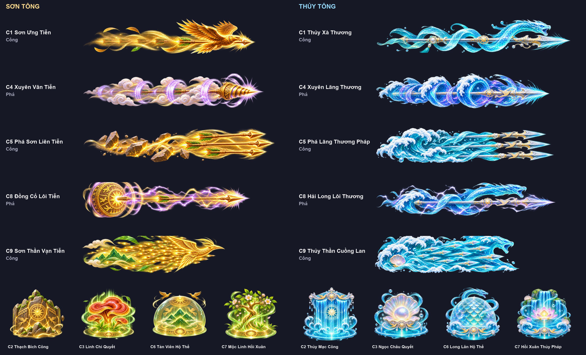

# Chiêu thức công pháp — tranh, cách hiện trên màn PK, hồ sơ làm ảnh động

18 chiêu, mỗi tông 9, khớp công pháp `C1`–`C9` ở Tàng Kinh Các (`CONG_PHAP` trong `loi/tang-bao.ts`, bảng ở
[ban-do.md](ban-do.md) §3d). Vẽ bằng ChatGPT Image ngày 2026-11-22, nền trong suốt thật.

## 1. Danh sách

| Mã | Sơn Tông (cung) | Thủy Tông (lao) | Hệ | Loại tranh | Hình |
|---|---|---|---|---|---|
| C1 | Sơn Ưng Tiễn | Thủy Xà Thương | Công | bay | Sơn: mũi tên hoá đại bàng vàng · Thủy: lao bạc có rắn nước quấn |
| C2 | Thạch Bích Công | Thủy Mạc Công | Thủ | quanh người | vách đá rêu khắc mặt trời · màn thác nước hình khiên |
| C3 | Linh Chi Quyết | Ngọc Châu Quyết | Máu | quanh người | nấm linh chi đỏ · vỏ sò ôm ngọc trai sáng |
| C4 | Xuyên Vân Tiễn | Xuyên Lãng Thương | Phá | bay | tên khoan xuyên mây, vòng xoáy tím · lao khoan xuyên sóng |
| C5 | Phá Sơn Liên Tiễn | Phá Lãng Thương Pháp | Công | bay | ba tên bọc lửa đá, đá vỡ văng · ba lao cưỡi sóng bạc đầu |
| C6 | Tản Viên Hộ Thể | Long Lân Hộ Thể | Thủ | quanh người | vòm ba đỉnh Tản, chim Lạc lượn · vòm vảy giao long |
| C7 | Mộc Linh Hồi Xuân | Hồi Xuân Thủy Pháp | Máu | quanh người | cây thần nở hoa · thác nhỏ, sen hồng |
| C8 | Đồng Cổ Lôi Tiễn | Hải Long Lôi Thương | Phá | bay | tên sét phóng ra từ mặt trống đồng · lao sét có giao long nước |
| C9 | Sơn Thần Vạn Tiễn | Thủy Thần Cuồng Lan | Công | bay | vạn tên vàng thành hình chim Lạc · sóng thần trăm lao, đầu giao long |

Không rồng Tàu, không chữ Hán (Kinh Thư §5). Giao long Thủy Tông không sừng, không râu.

## 2. File

| Chỗ | Gì |
|---|---|
| `web/son-ha-tien-lo/tranh-goc/chieu-cp-<tông>/_to-tan-cong.png`, `_to-ho-tro.png` | tờ gốc ChatGPT 1254² (1×5 dải chiêu bay, 2×2 chiêu quanh người) |
| `…/chieu-cp-<tông>/C<n>-<tông>.png` | **bản gốc từng chiêu**, PNG alpha, đủ độ phân giải (bay ~1300×300–400, quanh người ~640²) |
| `…/chieu-cp-<tông>/nen-xam/C<n>-<tông>.png` | cùng tranh trên **nền xám phẳng #808080**, khung 2:1 (bay) / 1:1 (quanh), cạnh chia hết 64 — để đưa AI video không hiểu alpha |
| `…/tranh-goc/chieu-cp/chieu.json` | sổ máy đọc: tên, hệ, loại, cỡ, điểm neo, **lời tả chuyển động** từng chiêu |
| `…/tranh-goc/chieu-cp/bang-chieu.jpg` | bảng xem nhanh 18 chiêu |
| `client/designs/tu-tien-son-ha/assets/chieu/<tông>-c<n>.webp` | bản game (bay rộng 640, quanh người 448²) |

Cắt và xuất lại: `python cong-cu/cat-luoi.py <tờ> tranh-goc/chieu-cp-<tông> <thư mục tạm> C1-<tông>,… 1x5 --dai`
(tờ hỗ trợ `2x2 --dai`), rồi `python cong-cu/chieu-cp.py <tông>` (chạy trong `web/son-ha-tien-lo`, đặt
`PYTHONIOENCODING=utf-8`). Lời nhắc vẽ: [`LOI-NHAC-TRANG-BI.md`](../../../web/son-ha-tien-lo/tranh-goc/LOI-NHAC-TRANG-BI.md) mục "Chiêu thức công pháp".

## 3. Trên màn PK (Đại Chiến) — `ve3d/chieu-cp.ts`, gọi từ `ve3d/canh-3d.ts`

- **Tiếp sức bằng bình luận và quần chiến** (`bayCheo`): người tung đang dùng công pháp hệ Công / Phá → tranh chiêu
  của môn đó bay vòng cung sang người bên kia thay cho quả cầu sáng; hệ Thủ / Máu → tranh bùng quanh người tung
  (mỗi người cách ≥ 2,6 giây, `CP_QUANH_CACH`) rồi vẫn bắn quả cầu như cũ.
- **Đòn Chủ Tướng** (`don`): Chủ Tướng có công pháp → 50% đòn (luôn khi bạo kích) tung tranh chiêu to ×1,8 (bạo ×2,4)
  thẳng vào chủ tướng bên kia.
- **Gõ 1–4** (`the.tungChieu`, chiêu bốc theo hệ phím): tranh chiêu của môn vừa bốc tung từ chính người gõ, ×1,35.
- **Tuyệt Kỹ** (quà 200 xu): tranh C9 của tông (Sơn Thần Vạn Tiễn / Thủy Thần Cuồng Lan) cỡ ×2,8.
- **Không còn quả cầu sáng tròn**: người chưa học công pháp và tinh binh tung chiêu nhập môn C1 của tông (nhỏ hơn ×0,8).
- **Hai chủ soái**: tranh chiêu tối thượng ×2,1 (bạo ×2,7), Sơn C9 · C8 · C5, Thủy C9 · C8 · C4 luân phiên. **Tiên phong**: công
  pháp đang dùng, chưa có thì theo căn cơ (C1 · C2 · C3 · C4). **Quà** Liên Kích C5, Bạo Kích C8.
- Nhiều nhất 16 tranh cùng lúc (`TOI_DA`); chiêu thần / Chủ Tướng / tiên phong / quà / Tuyệt Kỹ không bị giới hạn. Quá
  giới hạn thì không vẽ đường bay, người bên kia vẫn trúng.
- Cho tranh tĩnh có nhịp: chớp sáng nhanh (`sh-cp-chop`), chiêu từ ×1,3 kéo 2 bóng mờ nối đuôi. Vẫn chưa phải hoạt
  hình thật — xem §4.
- Chiêu bay sang trái (Thủy Tông) được lật dọc để không lộn ngược. Đầu chiêu neo ở 88% bề ngang (`NEO_X`).

## 4. Làm chiêu chuyển động như hoạt hình

Tranh tĩnh bay đã đẹp, nhưng muốn **đuôi chiêu cuộn, chim vỗ cánh, sóng vỡ, sét chớp** thì cần nhiều khung. Thay file
`assets/chieu/<tông>-c<n>.webp` bằng **WebP động cùng tên** là game tự chạy, không phải sửa mã. Điều kiện:

| | Chiêu bay | Chiêu quanh người |
|---|---|---|
| Tỉ lệ khung | giữ đúng tỉ lệ bản game (bay ~4:1) | vuông |
| Vị trí vật | đứng yên giữa khung, **không bay đi** (game tự lo đường bay) | đứng yên giữa khung |
| Đầu chiêu | ở bên phải, khoảng 86–90% bề ngang, giữa chiều cao | — |
| Độ dài | 1–1,5 giây, lặp liền (khung cuối nối khung đầu) | 1,5–2 giây, lặp liền |
| Khung / giây | 15–24 | 15–24 |
| Nền | trong suốt (alpha) | trong suốt |
| Cỡ file | ≤ 400 KB mỗi chiêu (Pillow `method=4`, quality 80) | ≤ 400 KB |

### Cách A — FramePack trên hpc (khuyên dùng: đã chạy tốt cho yêu tinh, giữ đúng nét tranh)

Có sẵn ở `scripts/phong/tu-tien/yeu-dong/` (xem [ban-do.md](ban-do.md) §7):

1. Chép bản gốc `C<n>-<tông>.png` lên hpc (`/mnt/Backup/dung-3d/.tmp/…`, không ghi vào `~` hay `/tmp`).
2. `yeu_fp.py <C<n>-<tông>.png> <ra> --loi "<chuyen_dong trong chieu.json> Static camera, the object stays in
   place and keeps its size, flat background." --giay 2` — tranh alpha tự được đặt lên nền phẳng. ~4–5 phút mỗi
   giây video trên 3070; FramePack ăn ~40 GB RAM, đừng chạy rembg song song.
3. `ghep_yeu.py` tách nền từng khung bằng **BiRefNet** (isnet cắt mất sóng / lửa / sét), ghép đi-về cho liền, ra
   WebP động; thu về cỡ bản game (bay rộng 640, quanh 448) rồi đặt đúng tên vào `assets/chieu/`.
4. Soát: xem một dải khung — vật không trôi, không đổi hình, đầu chiêu vẫn bên phải; hiệu ứng mờ (hào quang) không bị
   BiRefNet cắt cụt.

### Cách B — AI video khác (Kling, Runway, Hailuo, Veo…)

Đưa ảnh `nen-xam/C<n>-<tông>.png` (nền xám phẳng — AI video không đọc alpha) + lời tả `chuyen_dong` trong
`chieu.json` + câu khoá: *"Static camera, no zoom, no pan. The effect stays exactly in place and keeps its size and
shape. Flat gray background stays unchanged. Seamless loop."* Lấy video về, tách nền bằng BiRefNet / rembg, cắt
đoạn lặp, xuất WebP động như trên.

### Cách C — ChatGPT vẽ khung chính (khi AI video làm hỏng hình)

Xin ChatGPT vẽ **4–6 khung** của một chiêu trên một tờ (vẽ không nền, mỗi khung một hàng, cùng vị trí, chỉ khác
chuyển động: cánh lên / giữa / xuống…), rồi nội suy thêm khung bằng RIFE (`.tmp/rife` trên hpc). Khung ChatGPT lệch
nhau nhiều thì RIFE bị bóng mờ — chỉ dùng cho chuyển động nhỏ (vỗ cánh, nhịp sáng).

Không dùng MimicMotion (cần khung xương người) và không uốn lưới một tấm tĩnh (người vận hành chê "xấu").
